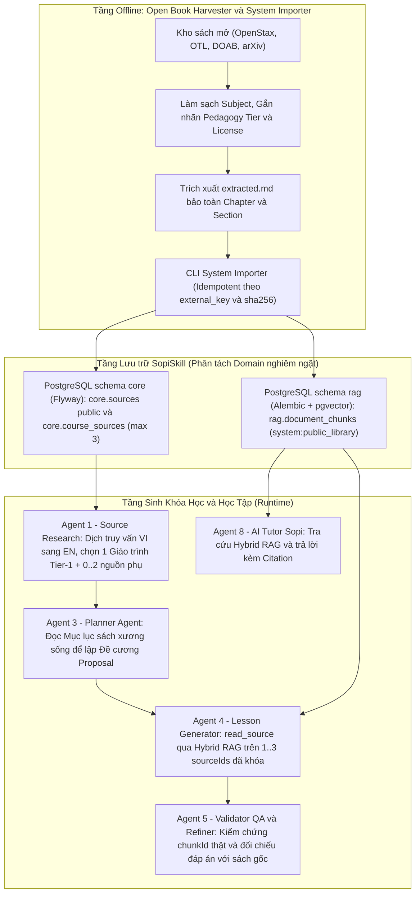

# Kế hoạch Triển khai Nền tảng Tri thức Giáo trình Mở cho SopiSkill (Phase L0 → Phase L6)

> **Mã tài liệu:** `PLAN-LIB-001`  
> **Ngày lập:** `2026-11-27`  
> **Nhánh cơ sở đã kiểm toán:** `feat/polyglot-phase9` (SopiSkill Polyglot: `core-api` Spring Boot 3.4 + `ai-engine` Python 3.12 + `frontend` Next.js 15)  
> **Kho tri thức nguồn đối chiếu:** `/home/nguyenhuu/Hoc Tap/Cào sách/library` (`8.2 GB`, `630` ấn phẩm trên `20` lĩnh vực, quản lý bởi SQLite FTS5 `catalog.db`)  
> **Quy ước nhãn bằng chứng (`sopi-repo-audit`):** **FACT** (đã xác minh trực tiếp từ code/DB thực tế), **INFERENCE** (suy luận kỹ thuật có căn cứ), **PROPOSAL** (thiết kế đề xuất trong kế hoạch này).  
> **Lưu ý đánh số Phase:** Đặt tên **`Phase L0` → `Phase L6`** (*Library Foundation Phases*) để tách biệt rõ ràng, không trùng lặp với `Phase 0` → `Phase 10` trong `plans/sopiskill_master_parity_plan.md`.

---

## 1. Bối cảnh, Mục tiêu & Hiện trạng Kiểm toán (Ground-Truth Audit)

### 1.1 Bài toán cốt lõi
Làm thế nào để biến kho sách học thuật mở (OpenStax, Open Textbook Library, DOAB, arXiv...) thành nền tảng tri thức giúp SopiSkill **tạo khóa học chuẩn kiến thức, chuẩn mạch sư phạm và kiểm chứng được trích dẫn**, mà **không bị loãng kết quả truy xuất (retrieval dilution), không xung đột ký hiệu giữa nhiều sách, và không phá vỡ tính cô lập dữ liệu người dùng**?

> [!IMPORTANT]
> **Nguyên lý kiến trúc cốt lõi:**
> - **Giàu ở tầng Thư viện (`Global Public Catalog`)** để bao phủ 20 lĩnh vực tri thức;
> - **Tinh gọn ở tầng Khóa học (`Course Working Set`: tối đa `1` giáo trình xương sống + `0..2` nguồn tham chiếu phụ)** để giữ mạch chương mục, thuật ngữ và ký hiệu nhất quán tuyệt đối trong suốt khóa học.

### 1.2 Hiện trạng kiểm toán trên SopiSkill (**FACT**)

| Thành phần | Trạng thái hiện tại trong code | Khoảng trống cần giải quyết |
|---|---|---|
| **Tạo khóa học (`POST /v1/courses`)** | `CourseController.java` đã đọc `core.sources.brief` khi có `sourceId` và gửi sang `/internal/interview/questions`. | Đề cương ban đầu `createInitialProposalIfAbsent` (dòng `809–881`) vẫn dựng 2 chương tĩnh (`"Nền tảng"` / `"Thực hành"`), chưa gọi Agent #3 (`planner_agent.py`) đọc mục lục sách gốc. |
| **Duyệt khóa học (`POST /v1/courses/{id}/approve`)** | Đẩy job `generate_course` vào Redis Stream `queue:ai:llm`. | `jobPayload` (dòng `684–704`) **chưa truyền `sourceIds` và `sourceBrief`** từ bảng `core.course_sources` sang worker. |
| **Sinh bài học (`worker_llm.py` & `lesson_generator.py`)** | Đã có vòng lặp tool `read_source` + `save_lesson` (`max_turns=6`) và vòng kiểm định `Writer → Validator QA → Refiner` (`<= 2` lượt). | `_default_source_reader` mặc định chỉ đọc `gist` ngắn (`<= 160` ký tự) trong `source_brief.sections`, **chưa truy vấn bảng vector `rag.document_chunks`** để lấy đoạn văn bản sách thật. |
| **Truy xuất Hybrid RAG (`RagRepository.search`)** | Đã có `pgvector` HNSW cosine + PostgreSQL FTS (`simple`) + Reciprocal Rank Fusion (`RRF`). | Đang lọc cứng `WHERE owner_id = :owner_id`, chưa hỗ trợ đọc chunk của các đầu sách thư viện dùng chung (`visibility = 'public'`). |
| **Khám phá & nghiên cứu nguồn (`SourcesAndResearchController.java`)** | `GET /v1/sources/discover` (dòng `156`) và `POST /v1/courses/{id}/research-runs` (dòng `636`) đang trả `List.of()` rỗng. | Chưa nối với kho sách `core.sources (visibility='public')` và endpoint `/internal/sources/research` của Agent #1. |
| **Embedding & Đa ngôn ngữ (`embedding.py`)** | Mặc định chạy `HashingEmbeddingProvider` (`hashing-ngram-v1`, 256 chiều, 0đ chi phí) + FTS `simple`. | Truy vấn tiếng Việt (`vi`) không tự khớp từ khóa với sách gốc tiếng Anh (`en`) nếu thiếu bước dịch truy vấn (`Cross-Lingual Query`) hoặc Multilingual Semantic Embedding. |

### 1.3 Hiện trạng kiểm toán kho sách `/home/nguyenhuu/Hoc Tap/Cào sách/library` (**FACT**)

Kết quả truy vấn trực tiếp trên `catalog.db` (`630` bản ghi, `8.2 GB`):
1. **Phân bổ nguồn:** `arxiv` (`392` bản — `62.2%`), `otl` (`123` giáo trình), `openstax` (`66` giáo trình), `doab` (`49` sách chuyên khảo). Định dạng: `621` PDF, `9` EPUB. Ngôn ngữ: `100%` tiếng Anh (`en`).
2. **Trích xuất Markdown:** Hiện `0/630` cuốn có `extracted.md` (`extracted_path IS NULL`). Hàm `_extract_pdf_markdown` trong `book_harvester/extractor.py` đã đọc được `reader.outline` (Mục lục bookmark PDF) ở đầu file nhưng thân bài mới đánh dấu `## Page {idx}`, chưa ánh xạ tiêu đề chương vào đúng trang.
3. **Dung lượng & Độ dài:** `93/630` cuốn nặng `> 25 MB` (lớn nhất `216.7 MB`), `172/630` cuốn dài `> 200` trang (dài nhất `3.648` trang) — vượt giới hạn cổng upload PDF cá nhân của người dùng (`25 MB / 200 trang`).
4. **Nhiễu phân loại `subject`:** Có sách gán nhầm lĩnh vực do khớp từ khóa rộng (ví dụ trong `computer-science` đang lẫn *Introduction to Sociology 3e*, *Introduction to Political Science*, *Anatomy and Physiology*, *Methods of Teaching Agriculture*).
5. **Giấy phép bản quyền (`license`):** Ít nhất `113` cuốn mang điều khoản phi thương mại (`CC BY-NC` / `CC BY-NC-SA`) và `392` bản dùng `arXiv.org Open Access License`; phần còn lại là `CC BY`, `CC BY-SA` được phép phái sinh thương mại khi ghi công đầy đủ.

---

## 2. Kiến trúc Tổng thể & Các Bất biến An toàn (Invariants)



### Năm nguyên tắc bất biến bắt buộc tuân thủ (`AGENTS.md`)
1. **Ranh giới Schema tuyệt đối:** `core.*` chỉ do Spring Boot (`core-api` + Flyway) ghi; `rag.*` chỉ do Python (`ai-engine` + Alembic) ghi. Importer nạp sách phải gọi qua API nội bộ có ký HMAC hoặc đi đúng 2 bước tách biệt, không viết chồng chéo ORM giữa hai service.
2. **100% Server-Authoritative Grading & 0 Answer-Key Leak:** Kho sách chỉ phục vụ biên soạn, kiểm định phía server và giải thích khái niệm; tuyệt đối không lộ `answerIndex`, `acceptedAnswers`, `solution` xuống client hay sang `TutorStreamInternalRequest`.
3. **Cô lập Tenant & Chống Prompt Injection:** Nội dung trích từ sách (kể cả sách OER mở) luôn được coi là dữ liệu không tin cậy về mặt điều khiển lệnh, bắt buộc bọc trong delimiter `<<<SOURCE_EVIDENCE_START>>> ... <<<SOURCE_EVIDENCE_END>>>` kèm chỉ thị không thực thi lệnh bên trong văn bản nguồn.
4. **Tách biệt Cổng Upload Người Dùng và Cổng Nạp Thư Viện Hệ Thống:** Giữ nguyên giới hạn `25 MB / 200 trang` trên `POST /v1/sources/upload` cho người dùng cuối để chống cạn kiệt tài nguyên (DoS).
5. **Chế độ Offline 0đ Chi phí cho CI/E2E:** Giữ nguyên `MockProvider` và `HashingEmbeddingProvider` hoạt động 100% tất định cho toàn bộ bộ test tự động; semantic embedding & DeepSeek LLM bật qua cấu hình môi trường rõ ràng, fail-fast khi thiếu key.

---

## 3. Lộ trình Phụ thuộc 7 Phase (`Phase L0` → `Phase L6`)

| Phase | Tên Phase | Trọng tâm | Thay đổi DB / Contract |
|---|---|---|---|
| **Phase L0** | Vệ sinh Git Baseline & Chuẩn hóa Dữ liệu `Open Book Harvester` | Chốt nhánh `feat/polyglot-phase9`; sửa gán nhầm `subject`, gắn nhãn `tier`/`license`, nâng cấp `extracted.md` có Heading chương mục | Chỉ cập nhật bên `Cào sách` (0 đổi DB SopiSkill) |
| **Phase L1** | Nối Kín Đường Ống `Source → Proposal → Lesson Generator` | Vá 3 điểm hở giữa `core-api` và `ai-engine`; nối `read_source` của Lesson Generator vào Hybrid RAG thật | Mở rộng tương thích ngược `internal-ai.yaml` |
| **Phase L2** | Kho Tri Thức Dùng Chung (`Public Library Scope`) & Bảo mật Đa Tenant | Cho phép mọi khóa học truy xuất nguồn `public` (`system:public_library`) mà vẫn khóa chặt tài liệu `private` của từng user | Flyway `V7` (`core.sources` + `core.course_sources`) & Alembic `0002` (`rag`) |
| **Phase L3** | Heading-Aware Markdown Chunker & CLI Nạp Thư Viện (`System Importer`) | Băm chunk theo Chương/Mục (bảo toàn công thức LaTeX & code), mở rộng `source.brief` phủ toàn sách, nạp lô Pilot idempotent | Thêm `sourceKind="markdown_library"` nội bộ |
| **Phase L4** | Cầu Nối Truy Vấn Đa Ngôn Ngữ (`VI ↔ EN`) & Xếp Hạng Sư Phạm Agent #1 | Dịch truy vấn sang tiếng Anh khi tra sách gốc `en`; ưu tiên Giáo trình `openstax`/`otl` trước `arxiv`; nối `/v1/sources/discover` & `research-runs` | Giữ nguyên hợp đồng `/v1/*` hiện hành |
| **Phase L5** | Kiểm Chứng Trích Dẫn Chặt (`Validator QA`) & Ghi Công Giấy Phép (`Attribution`) | Chặn 100% citation bịa; đối chiếu đáp án quiz với đoạn trích sách gốc; hiển thị Attribution chuẩn giấy phép `CC BY` & lọc `commercial_safe` | Bổ sung trường optional `attribution` trong response nguồn/bài học |
| **Phase L6** | Benchmark Thực Nghiệm (`sopi-ai-evaluation`) & Rollout Kho Sách Theo 3 Đợt | Đo lường định lượng A/B/C trên `>= 12` chủ đề song ngữ; nạp mở rộng từ Pilot 25 cuốn → 189 giáo trình → chuyên khảo sâu | Không đổi schema |

---

## 4. Đặc tả Chi tiết Từng Phase

---

### Phase L0 — Vệ sinh Git Baseline & Chuẩn hóa Kho Sách Đầu Vào (`Open Book Harvester`)

#### Mục tiêu
Đảm bảo nhánh SopiSkill sạch sẽ trước khi mở nhánh mới, đồng thời loại bỏ nhiễu phân loại và trích xuất văn bản có cấu trúc chương mục ngay tại nguồn `/home/nguyenhuu/Hoc Tap/Cào sách`.

#### Phạm vi & Các bước thực hiện theo thứ tự
1. **Chốt sạch Working Tree trên SopiSkill (`/home/nguyenhuu/Hoc Tap/Reverse Engineer`):**
   - Chạy kiểm tra bộ test hiện hữu của `ai-engine` trên `feat/polyglot-phase9`.
   - Commit sạch đợt chuẩn hóa 8 Agent đang dở trên `feat/polyglot-phase9`, sau đó tạo nhánh làm việc mới `feat/library-foundation`.
2. **Sửa phân loại `subject` bị nhiễu trong `Open Book Harvester` (`/home/nguyenhuu/Hoc Tap/Cào sách`):**
   - Rà soát hàm phân loại lĩnh vực trong `src/book_harvester/` và `config.yaml`: bắt buộc so khớp ranh giới từ (`word boundary`) và ưu tiên ánh xạ trực tiếp từ danh mục gốc của OpenStax/OTL (`Social Sciences` → `social-sciences`, `Anatomy and Physiology` → `medicine-health` / `biology`, `Pure Mathematics` → `mathematics`) thay vì khớp chuỗi con gây nhầm về `computer-science`.
   - Viết lệnh bảo trì `reclassify` cập nhật lại `subject`, `domains_json` và chỉ mục `books_fts` trong `catalog.db`.
3. **Chuẩn hóa nhãn Phân tầng Sư phạm (`pedagogy_tier`) & Cờ Thương mại (`commercial_safe`) trong `metadata.json`:**
   - Quy tắc tất định từ `source` + `license`:
     - `pedagogy_tier`:
       - `openstax`, `otl` → `tier1_textbook` (Giáo trình đại học có cấu trúc chương bài tuần tự);
       - `doab`, `oapen`, `gutenberg` → `tier2_monograph` (Sách chuyên khảo / kinh điển);
       - `arxiv` → `tier3_paper` (Bài báo nghiên cứu / survey chuyên sâu).
     - `commercial_safe`:
       - `true` **chỉ khi** giấy phép thuộc tập cho phép sử dụng thương mại rõ ràng (`CC BY 3.0/4.0`, `CC BY-SA 3.0/4.0`, `CC0`, `Public Domain`) **và không chứa** `NonCommercial` / `NC` / `ND`;
       - `false` cho mọi trường hợp còn lại (`CC BY-NC*`, `arXiv.org Open Access License`, hoặc chưa rõ).
4. **Nâng cấp bộ trích xuất Markdown bảo toàn Chương/Mục (`src/book_harvester/extractor.py`):**
   - Trong `_extract_pdf_markdown`: trích xuất bảng ánh xạ `(page_number -> list[heading_title, level])` từ cây bookmark `reader.outline` của `pypdf` (hoặc `PyMuPDF` `doc.get_toc()` nếu cài đặt) để chèn tiêu đề `# / ## / ###` đúng tại trang bắt đầu mỗi chương/mục thay vì chỉ ghi `## Page {idx}` đơn điệu.
   - Chạy trích xuất lô ưu tiên **Tier 1 (`189` giáo trình `openstax` + `otl`)** tạo sẵn file `extracted.md` chuẩn UTF-8.

#### Tiêu chí nghiệm thu & Lệnh kiểm thử (Gate L0)
- `git status --short` trên SopiSkill sạch hoàn toàn trên nhánh mới `feat/library-foundation`.
- Truy vấn kiểm tra trên `catalog.db`: `0` cuốn Xã hội học / Chính trị học / Giải phẫu học / Nông nghiệp còn nằm trong `subject = 'computer-science'`.
- Chạy `pytest` bên `/home/nguyenhuu/Hoc Tap/Cào sách` pass 100%; kiểm tra mẫu tối thiểu 5 cuốn OpenStax/OTL có `extracted.md` chứa đầy đủ YAML frontmatter, `## Table of Contents` và các tiêu đề chương `## Chapter ...`.

#### Loại trừ (Exclusions)
- Không tải thêm hàng chục GB sách mới ở bước này; tập trung làm sạch 630 cuốn đã có (đặc biệt là 189 giáo trình Tier-1).

---

### Phase L1 — Nối Kín Đường Ống `Source → Proposal → Lesson Generator` (`core-api` ↔ `ai-engine`)

#### Mục tiêu
Đây là **thay đổi kỹ thuật ưu tiên số 1 trên SopiSkill**: đảm bảo khi một khóa học có gắn tài liệu nguồn trong `core.course_sources`, cả 3 khâu **Lập đề cương (`Proposal`)**, **Viết bài học (`Lesson Generator`)** và **Trợ giảng (`Sopi Tutor`)** đều nhận được dữ liệu thật từ sách gốc.

#### Modules & Files bị ảnh hưởng
- `contracts/internal-ai.yaml`
- `ai-engine/app/schemas/internal.py`, `ai-engine/app/api/internal.py`
- `ai-engine/app/workers/worker_llm.py`, `ai-engine/app/agents/lesson_generator.py`
- `core-api/src/main/java/com/sopiskill/core/internal/AiEngineClient.java`
- `core-api/src/main/java/com/sopiskill/core/course/CourseController.java`
- `core-api/src/main/java/com/sopiskill/core/internal/InternalCallbackController.java`
- `core-api/src/main/java/com/sopiskill/core/tutor/TutorController.java`

#### Các bước thực hiện theo thứ tự
1. **Mở rộng tương thích ngược Hợp đồng Nội bộ (`contracts/internal-ai.yaml` & `schemas/internal.py`):**
   - Thêm endpoint nội bộ `POST /internal/proposal/generate` gọi `generate_proposal_with_tools(...)` của Agent #3 (`planner_agent.py`), nhận `{courseId, topic, language, learnerProfile, sourceBrief}` và trả `{proposal, toolsCalled, turnsUsed, usage}`.
   - Bổ sung các trường tùy chọn (có default `None`/`[]` để không phá vỡ tương thích ngược):
     - `LlmQueueJobMessage.payload`: `sourceIds: list[str]`, `sourceBrief: dict | None`, `sourceLanguages: list[str]`.
     - `TutorStreamInternalRequest`: `sourceIds: list[str] | None = None`.
     - `LessonReadyCallbackRequest`: `citations: list[dict] = []`, `grounding: Literal["source_grounded", "general_ai_knowledge"] = "general_ai_knowledge"`.
2. **Nối `CourseController.java` & `TutorController.java` (`core-api`):**
   - Viết phương thức dùng chung truy vấn tối đa `3` nguồn liên kết của khóa học từ `core.course_sources JOIN core.sources` để lấy `sourceIds` (`src_...`), `primarySourceBrief` (ưu tiên nguồn chính), và `language` của nguồn.
   - Tại `CourseController.createInitialProposalIfAbsent(...)`: gọi `aiEngine.generateProposal(...)` truyền kèm `primarySourceBrief` để Đề cương v1 chia chương/bài theo đúng mục lục tài liệu gốc; nếu `ai-engine` timeout hoặc ở chế độ fallback mới dùng khung 2 chương mặc định.
   - Tại `CourseController.approveCourse(...)`: đính `sourceIds`, `sourceBrief`, `sourceLanguages` vào `jobPayload` gửi lên `queue:ai:llm`.
   - Tại `TutorController.java`: đính `sourceIds` và `sourceBrief` của khóa học khi gọi `/internal/tutor/stream`.
3. **Nối `worker_llm.py` & `lesson_generator.py` vào `RagRepository.search` (`ai-engine`):**
   - Trong `handle_llm_job` (khi xử lý `generate_course`, `generate_lesson`, `regenerate_unit`): nếu `payload.sourceIds` không rỗng, khởi tạo `RagRepository` + `AsyncSession` và truyền hàm `hybrid_rag_source_reader` vào `generate_lesson_with_qa_loop(...)`.
   - Khi Agent #4 gọi tool `read_source(anchor, query)`:
     - Gọi `rag_repo.search(session, owner_id=owner_id, course_id=course_id, query=effective_query, source_ids=source_ids, top_k=4)`.
     - Trả về danh sách đoạn trích thật (`chunkId`, `sourceId`, `pageNumber`, `sectionAnchor`, `excerpt`) được bọc trong ranh giới an toàn `<<<SOURCE_EVIDENCE_START>>> ... <<<SOURCE_EVIDENCE_END>>>`.
     - Nếu chưa có chunk trong DB (ví dụ test đơn vị thuần in-memory) thì fallback mượt về `_default_source_reader(source_brief)`.
   - Thu thập các `chunkId` có thật đã được trả ra trong phiên sinh bài để đính kèm `citations[]` (`validation_status = 'locator_verified'`) và `grounding = 'source_grounded'` vào callback `POST /internal/jobs/{jobId}/lesson-ready`.
4. **Lưu `core.lesson_citations` tại `InternalCallbackController.java`:**
   - Trong `lessonReady(...)`: xóa-rồi-ghi idempotent các bản ghi `core.lesson_citations` cho `lesson_id` tương ứng (chỉ chấp nhận `sourceId` thực sự thuộc `core.course_sources` của khóa học đó — server kiểm tra lại, không bao giờ tin mù payload).

#### Tiêu chí nghiệm thu & Lệnh kiểm thử (Gate L1)
- `cd ai-engine && ../backend/.venv/bin/python -m pytest -v -k "not test_live_"` → **exit `0`** (thêm test `test_phase_l1_rag_lesson_grounding.py` xác minh `worker_llm` đọc chunk 800 ký tự từ SQLite/pgvector `RagRepository`, bọc delimiter chống prompt injection, và ghi nhận đúng `citations`).
- `cd ai-engine && ../backend/.venv/bin/python -m bandit -r app -q` → **exit `0` (0 findings)**.
- `cd core-api && ./mvnw -B test` → **exit `0`** (thêm JUnit integration test: gắn nguồn PDF vào khóa học → hoàn tất phỏng vấn sinh Proposal bám `sourceBrief` → `approve` truyền đủ `sourceIds` → nhận callback `lesson-ready` lưu đúng `core.lesson_citations` và từ chối `sourceId` ngoại lai).
- Toàn bộ Playwright E2E hiện có giữ nguyên trạng thái PASS 100% (0 thay đổi breaking với Frontend).

#### Rollback & Loại trừ
- **Rollback:** Revert nhánh `feat/library-foundation` (Phase L1 chưa thêm bất kỳ bảng/cột DB mới nào).
- **Loại trừ:** Chưa nạp kho sách 630 cuốn ở Phase L1; chỉ nối thông đường ống kỹ thuật.

---

### Phase L2 — Kiến trúc Kho Tri Thức Dùng Chung (`Public Library Scope`) & Cô Lập Đa Tenant

#### Mục tiêu
Cho phép mọi học viên kế thừa chung các đầu sách chuẩn của hệ thống (`visibility = 'public'`) từ duy nhất một bản lưu vector trong `rag.document_chunks`, đồng thời **đảm bảo 0% khả năng Học viên A đọc được tài liệu `private` của Học viên B**.

#### Modules & Files bị ảnh hưởng
- `core-api/src/main/resources/db/migration/V7__public_library_catalog_and_course_source_roles.sql` *(kiểm tra số version Flyway liền sau `V6`)*
- `ai-engine/alembic/versions/0002_public_library_scope_index.py`
- `ai-engine/app/rag/repository.py`
- `core-api/src/main/java/com/sopiskill/core/sources/SourcesAndResearchController.java`

#### Các bước thực hiện theo thứ tự
1. **Migration Flyway Additive trên Schema `core` (`core-api`):**
   - Mở rộng `core.sources` (`ADD COLUMN IF NOT EXISTS`):
     - `external_key VARCHAR(160)` + unique partial index `WHERE external_key IS NOT NULL` (định danh duy nhất cho sách thư viện, ví dụ `openstax:775`, `otl:1017`);
     - `domain_slug VARCHAR(64)` (khớp 20 lĩnh vực chuẩn của SopiSkill);
     - `pedagogy_tier VARCHAR(24) NOT NULL DEFAULT 'user_upload'` (`tier1_textbook | tier2_monograph | tier3_paper | official_docs | user_upload`);
     - `commercial_safe BOOLEAN NOT NULL DEFAULT FALSE`;
     - `isbn VARCHAR(64)`, `doi VARCHAR(128)`.
   - Mở rộng `core.course_sources` (`ADD COLUMN IF NOT EXISTS`):
     - `role VARCHAR(24) NOT NULL DEFAULT 'reference'` (`primary | reference`);
     - Partial unique index đảm bảo mỗi `course_id` có tối đa **1** nguồn `role = 'primary'`.
2. **Migration Alembic Additive trên Schema `rag` (`ai-engine`):**
   - Định nghĩa hằng số hệ thống `PUBLIC_LIBRARY_OWNER_ID = "system:public_library"`.
   - Thêm partial index `ix_rag_chunks_public_source ON rag.document_chunks (source_id) WHERE owner_id = 'system:public_library'` để truy vấn theo `source_id` trên hàng trăm nghìn chunk đạt độ trễ vài mili-giây.
3. **Cập nhật luật truy vấn an toàn trong `RagRepository.search` (`ai-engine/app/rag/repository.py`):**
   - **Trường hợp 1 (`source_ids` rỗng / `None`):** Giữ nguyên câu lệnh cũ — chỉ tìm trong `owner_id = :owner_id AND (course_id = :course_id OR course_id IS NULL)` (tuyệt đối không quét mù toàn bộ kho `system:public_library` gây nhiễu chéo môn học).
   - **Trường hợp 2 (`source_ids` có giá trị — đã được `core-api` kiểm quyền trước khi gọi):**
     ```sql
     WHERE source_id = ANY(:source_ids)
       AND (
         (owner_id = :owner_id AND (course_id = :course_id OR course_id IS NULL))
         OR (owner_id = 'system:public_library' AND course_id IS NULL)
       )
     ```
   - Áp dụng đồng nhất cho cả nhánh `postgresql` (pgvector + FTS) và nhánh `sqlite` (unit test offline).
4. **Khóa quyền xóa & sửa nguồn `public` tại `core-api`:**
   - Xác nhận mọi thao tác `DELETE /v1/sources/{id}`, `POST /v1/sources/{id}/document`, `POST /v1/sources/{id}/ingest` của user thường vẫn kiểm tra chặt `owner_id = :currentUserId` (trả `404` nếu user cố ghi đè hoặc xóa sách `public` của hệ thống).

#### Tiêu chí nghiệm thu & Lệnh kiểm thử (Gate L2)
- **Kiểm thử bảo mật đa tenant bắt buộc (`test_public_library_and_tenant_isolation.py` + JUnit):**
  1. Nguồn `public` (`owner_id = 'system:public_library'`) được liên kết vào khóa học của User A và User B → cả hai tìm kiếm RAG qua `POST /v1/courses/{id}/sources/search` đều nhận đúng các đoạn trích của cuốn sách đó.
  2. User A upload PDF riêng (`owner_id = 'usr_A'`) → User B giả mạo truyền `sourceIds: ["src_private_cua_A"]` vào khóa học của User B → `core-api` chặn `404` khi link nguồn **và** ngay cả khi gọi thẳng xuống `RagRepository.search(owner_id="usr_B", source_ids=["src_private_cua_A"])` cũng trả về **đúng `0` chunks**.
  3. User A gọi `DELETE /v1/sources/{src_public}` → bị chặn `404`, kho sách công cộng nguyên vẹn 100%.

#### Rollback
- Các migration Flyway & Alembic thuần additive (`ADD COLUMN IF NOT EXISTS`, `CREATE INDEX IF NOT EXISTS`), an toàn tuyệt đối với dữ liệu cũ và không dùng bất kỳ lệnh xóa bảng/volume nào.

---

### Phase L3 — Heading-Aware Markdown Chunker & Công Cụ Nạp Thư Viện Hàng Loạt (`System Library Importer`)

#### Mục tiêu
Xây dựng bộ băm văn bản tôn trọng cấu trúc **Chương → Mục → Công thức/Code** cho giáo trình dài 400–1.000 trang, sửa giới hạn cắt cụt mục lục ở `brief_builder.py`, và tạo công cụ CLI nạp sách tự động từ `/home/nguyenhuu/Hoc Tap/Cào sách/library` vào SopiSkill.

#### Modules & Files bị ảnh hưởng
- `ai-engine/app/rag/extractor.py`
- `ai-engine/app/rag/brief_builder.py`
- `ai-engine/app/workers/worker_ingest.py`
- `core-api/src/main/java/com/sopiskill/core/internal/InternalCallbackController.java` (hoặc `/internal/library/upsert` bảo vệ bằng HMAC)
- `ai-engine/scripts/import_open_library.py` *(mới)*

#### Các bước thực hiện theo thứ tự
1. **Xây dựng `chunk_markdown_by_headings` trong `ai-engine/app/rag/extractor.py`:**
   - Bóc tách YAML frontmatter của `extracted.md`.
   - Phân tích cây tiêu đề `#`, `##`, `###` để theo dõi ngữ cảnh phân cấp hiện tại (ví dụ: `Chapter 4: Functions > 4.2 Parameters and Arguments`) và sinh `section_anchor` tất định (`ch4-4-2-parameters-and-arguments`).
   - Ghi nhận số trang `page_number` từ các mốc trang trong Markdown để trích dẫn chính xác tới trang PDF gốc.
   - **Bảo toàn khối nguyên tử:** Không bao giờ cắt ngang bên trong khối mã nguồn ```` ``` ... ``` ```` hoặc khối toán học LaTeX `$$ ... $$` / `\begin{...}...\end{...}` (kích thước chunk mục tiêu `900..1200` ký tự, overlap theo ranh giới câu).
   - Tiêm dòng tiêu đề ngữ cảnh mỏng ở đầu mỗi chunk (`[Source: {title} | Section: {breadcrumb}]`) giúp cả FTS lẫn Vector hiểu đúng ngữ cảnh dù đoạn văn chỉ viết *"Theo định lý trên..."*.
2. **Mở rộng `build_source_brief` cho Sách Dài trong `ai-engine/app/rag/brief_builder.py`:**
   - Thay vì chỉ lấy `headings[:40]` (vốn sẽ bị 40 tiểu mục của Chương 1–2 chiếm hết đối với sách 500 trang), ưu tiên lấy **toàn bộ các tiêu đề cấp Chương (`H1`/`H2`) xuyên suốt từ đầu đến cuối sách** trước, rồi mới điền thêm các mục con quan trọng (tối đa `60` mục đại diện toàn sách). Nhờ đó, **Planner Agent (#3)** thấy được bức tranh tổng thể từ Chương mở đầu đến Chương nâng cao cuối sách.
3. **Xây dựng công cụ nạp lô `ai-engine/scripts/import_open_library.py`:**
   - Đọc `catalog.db` ở chế độ chỉ đọc (`?mode=ro`) cùng `metadata.json` và `extracted.md`.
   - Hỗ trợ đầy đủ cờ điều khiển an toàn:
     - `--library-dir "/home/nguyenhuu/Hoc Tap/Cào sách/library"`
     - `--tiers tier1_textbook` *(mặc định chỉ nạp `openstax` + `otl`)*
     - `--domains computer-science,mathematics`
     - `--commercial-only` *(chỉ nạp sách `commercial_safe = true` khi chuẩn bị môi trường thương mại)*
     - `--limit N` & `--dry-run`
   - **Cơ chế Idempotent tuyệt đối:** Tính `external_key = "{source}:{source_id}"` và kiểm tra `(external_key, content_hash, pipeline_version="md-heading-v1")`. Nếu cuốn sách đã được nạp và `sha256` không đổi, script bỏ qua ngay trong `< 5ms`, không tốn CPU/API re-embed.
   - **Tuân thủ ranh giới Domain:** Metadata nguồn (`core.sources`, `core.source_documents`) được upsert qua endpoint nội bộ ký HMAC trên `core-api` (`POST /internal/library/sources/upsert`), còn chunks/vectors được ghi vào `rag.document_chunks` (`owner_id = 'system:public_library'`) bởi `ai-engine`.

#### Tiêu chí nghiệm thu & Lệnh kiểm thử (Gate L3)
- Unit test trên `ai-engine`: truyền một tài liệu Markdown dài 12 chương có chứa khối code Python và công thức `$$ \int_0^1 x^2 dx $$` → xác nhận `0` khối code/toán bị xé đôi, `source.brief.sections` phủ đủ cả 12 chương từ đầu tới cuối, `section_anchor` và `page_number` chính xác.
- Test tích hợp Importer: nạp thử 3 cuốn sách mẫu → kiểm tra `core.sources` có `visibility='public'`, `pedagogy_tier='tier1_textbook'`, `rag.document_chunks` có đủ chunks; chạy lại lệnh lần 2 → báo `skipped=3, reindexed=0`.

---

### Phase L4 — Cầu Nối Truy Vấn Đa Ngôn Ngữ (`VI ↔ EN`) & Định Tuyến Sách Sư Phạm (Agent #1)

#### Mục tiêu
Giải quyết bài toán thực tế quan trọng nhất đối với người học Việt Nam: **học viên nhập chủ đề & học bằng tiếng Việt (`vi`), kho sách chuẩn 100% là tiếng Anh (`en`)**, đồng thời giúp Agent #1 tự động chọn đúng **1 giáo trình xương sống + tối đa 1–2 nguồn phụ** phù hợp với trình độ người học.

#### Modules & Files bị ảnh hưởng
- `ai-engine/app/agents/source_research_agent.py`
- `ai-engine/app/agents/tool_schemas.py`, `ai-engine/app/agents/providers.py`
- `ai-engine/app/rag/query_bridge.py` *(mới — chuẩn hóa & mở rộng truy vấn song ngữ VI ↔ EN)*
- `core-api/src/main/java/com/sopiskill/core/sources/SourcesAndResearchController.java`
- `core-api/src/main/java/com/sopiskill/core/course/CourseController.java`

#### Các bước thực hiện theo thứ tự
1. **Xây dựng Cầu Nối Truy Vấn Song Ngữ (`ai-engine/app/rag/query_bridge.py` & `tool_schemas.py`):**
   - Trong JSON Schema của tool `read_source` (ở cả Agent #4 `Lesson Generator` và Agent #8 `Sopi Tutor`) và `search_sources` (Agent #1):
     - Thêm hướng dẫn tường minh và trường `englishQuery` (tùy chọn): khi tài liệu nguồn có `language = "en"` mà khóa học đang ở `language = "vi"`, LLM sinh truy vấn tìm kiếm bằng thuật ngữ chuẩn tiếng Anh song song với câu hỏi gốc, sau đó biên soạn lời giảng sang tiếng Việt kèm thuật ngữ gốc trong ngoặc (ví dụ: *Cây tìm kiếm nhị phân (Binary Search Tree)*).
   - Ở chế độ `MockProvider` / offline không tốn phí LLM: `query_bridge.py` dùng bảng ánh xạ thuật ngữ học thuật song ngữ `VI → EN` phủ toàn bộ 20 lĩnh vực (kế thừa bộ từ khóa song ngữ đã có trong `config.yaml` của `Open Book Harvester`) để mở rộng câu truy vấn FTS/Hashing.
   - Hỗ trợ cấu hình khuyến nghị cho môi trường thực tế: `EMBEDDING_PROVIDER=openai_compatible` dùng model đa ngôn ngữ (như `BAAI/bge-m3` qua TEI/vLLM nội bộ hoặc API tương thích).
2. **Thuật toán Chọn Sách Theo Bậc Sư Phạm (`Pedagogical Ranking` trên `core-api` & Agent #1):**
   - Nâng cấp `GET /v1/sources/discover?q=...` và `POST /v1/courses/{courseId}/research-runs` tại `SourcesAndResearchController.java` (thay thế `List.of()` rỗng hiện tại):
     - Tìm ứng viên từ kho sách nội bộ `core.sources WHERE visibility = 'public'` (lọc thêm `commercial_safe = TRUE` nếu cờ cấu hình `BILLING_COMMERCIAL_STRICT_SOURCES=true` đang bật).
     - Chấm điểm xếp hạng ứng viên theo `learnerProfile`:
       - Với `currentLevel` là `beginner` hoặc `intermediate` (hoặc `depth != 'deep'`): ưu tiên tuyệt đối **`tier1_textbook` (`openstax`, `otl`)** > `official_docs` > `tier2_monograph`; **loại bỏ `tier3_paper` (`arxiv`)** khỏi vị trí sách chính để tránh làm khóa học nhập môn bị quá tải toán học/nghiên cứu hẹp.
       - Với `currentLevel == 'advanced'` hoặc `depth == 'deep'`: chọn **1 cuốn `tier1_textbook`** giữ vai trò `role = 'primary'` (làm khung đề cương) + **1–2 ấn phẩm `tier2_monograph` / `tier3_paper`** giữ vai trò `role = 'reference'` (bổ sung chiều sâu).
   - Khi người học tạo khóa học mới mà chưa tự upload PDF (`sourceId == null`), tự động gợi ý hoặc liên kết bộ `1..3` nguồn chuẩn tốt nhất vừa tìm được vào `core.course_sources` (nguồn điểm cao nhất mang `role = 'primary'`).

#### Tiêu chí nghiệm thu & Lệnh kiểm thử (Gate L4)
- **Test chọn nguồn chống nhiễu:** Khi kho có cả giáo trình *Introduction to Python Programming (OpenStax)* và 5 bài báo `arxiv` hẹp có chữ *"Python"*, tạo khóa học tiếng Việt *"Học lập trình Python từ đầu"* (`beginner`) → hệ thống chọn đúng cuốn OpenStax làm `primary`, `0` bài báo `arxiv` ngách bị lọt vào khóa nhập môn.
- **Test truy vấn chéo ngôn ngữ (`VI → EN`):** Bài học tiếng Việt gọi `read_source` truy xuất thành công đoạn văn tiếng Anh tương ứng trong sách OpenStax và sinh block `teach` + `course_glossary_terms` bằng tiếng Việt chuẩn xác.

---

### Phase L5 — Kiểm Chứng Sự Thật Trên Validator QA (#5) & Minh Bạch Bản Quyền (`Attribution`)

#### Mục tiêu
Khóa chặt đầu ra của LLM bằng cơ chế đối chiếu ngược với các đoạn sách đã đọc (tránh trường hợp *"có gắn sách nhưng LLM vẫn tự bịa kiến thức sai hoặc gán bừa trích dẫn"*), đồng thời tuân thủ đầy đủ nghĩa vụ ghi công tác giả theo giấy phép Creative Commons (`CC BY`).

#### Modules & Files bị ảnh hưởng
- `ai-engine/app/agents/validator_qa.py`
- `ai-engine/app/agents/lesson_generator.py`
- `core-api/src/main/java/com/sopiskill/core/lesson/PublicBlockProjector.java`
- `core-api/src/main/java/com/sopiskill/core/lesson/LessonController.java`
- `frontend/src/components/lesson/CitationChip.tsx` *(chỉ hiển thị thêm thông tin nguồn/giấy phép nếu có, tương thích ngược hoàn toàn)*

#### Các bước thực hiện theo thứ tự
1. **Kiểm chứng Locator Tất Định 100% ở Tầng 1 (`validator_qa.py`):**
   - Đối chiếu mọi `block.cite` trong các block `teach` với tập hợp `(anchor, chunkId, pageNumber, sourceId)` thực sự đã được tool `read_source` trả ra trong phiên sinh bài học đó.
   - Nếu LLM tự chế ra `anchor` hoặc `chunkId` không nằm trong tập đã đọc → code tất định xóa bỏ liên kết giả và ghi nhận cảnh báo kiểm định, đảm bảo **100% citation xuất ra giao diện đều có thật trong DB (`locator_verified`)**.
2. **Đối chiếu Đáp Án & Kiến Thức với Sách Gốc ở Tầng 2 (`VALIDATOR_LLM_ENABLED=true`):**
   - Truyền kèm các đoạn `source_excerpts` gốc vào prompt của **Agent #5 (`Validator / QA Agent`)** khi chạy trên DeepSeek/OpenAI.
   - Nếu nội dung `teach` hoặc đáp án câu hỏi (`mc`, `blank`, `speed`, `short`) mâu thuẫn với định nghĩa/công thức trong `source_excerpts` → Agent #5 gọi tool `flag_question` với mã chuẩn (`wrong_answer`, `ambiguous`, `unanswerable`) → kích hoạt `Refiner` sửa lại trực tiếp dựa trên đoạn trích sách gốc (tối đa `2` lượt).
3. **Hiển thị Ghi Công Bản Quyền Mở (`Open-License Attribution`):**
   - Các giáo trình OpenStax và OTL cấp phép theo `CC BY 4.0` yêu cầu ghi nhận Tên sách, Tác giả, Nhà xuất bản, Giấy phép và Link gốc (ví dụ đối với OpenStax: *"Access for free at openstax.org"*).
   - Bổ sung khối metadata `attributions[]` (`title`, `author`, `publisher`, `licenseInfo`, `canonicalUrl`) trong phản hồi nguồn của khóa học/bài học để `CitationChip` và chân trang khóa học hiển thị minh bạch, đúng luật bản quyền quốc tế.

#### Tiêu chí nghiệm thu & Lệnh kiểm thử (Gate L5)
- Unit test & Integration test:
  1. Bơm một bản nháp bài học có `cite` trỏ tới `anchor` không tồn tại → bộ lọc tước sạch `cite` giả, không bao giờ lưu `locator_verified` sai sự thật.
  2. Bơm một câu hỏi `mc` có `answerIndex` ngược với công thức trong `source_excerpts` → Validator gắn cờ `wrong_answer` → Refiner sửa lại đúng đáp án theo sách gốc trong `<= 2` lượt.
  3. Kiểm tra API `GET /v1/lessons/{id}` vẫn giữ **0 byte lộ đáp án** (`answerIndex`, `answers`, `acceptedAnswers`, `solution` bị lọc sạch 100%) đồng thời trả đúng thông tin `attributions` của sách CC BY.

---

### Phase L6 — Bộ Đánh Giá Định Lượng (`sopi-ai-evaluation`) & Chiến Lược Nạp Mở Rộng 3 Đợt

#### Mục tiêu
Đo lường bằng bằng chứng thực nghiệm (không đánh giá cảm tính qua 1–2 ví dụ lẻ) để xác nhận kiến trúc phân tầng sách thực sự vượt trội so với không dùng sách và so với nhồi toàn bộ sách, trước khi nạp rộng toàn kho.

#### Modules & Files bị ảnh hưởng
- `ai-engine/tests/eval/eval_library_course_quality.py` *(mới — tách riêng khỏi suite unit test 0đ mặc định)*
- `ai-engine/tests/eval/fixtures_12_topics.json` *(mới)*
- `docs/development-progress.md` *(ghi nhận báo cáo kết quả thực tế)*

#### Các bước thực hiện theo thứ tự
1. **Thiết lập Bộ Fixture Đánh giá `>= 12` Chủ đề (`sopi-ai-evaluation`):**
   - Gồm:
     - `9` chủ đề có giáo trình chuẩn trong kho (trải đều Công nghệ thông tin, Toán, Vật lý, Hóa, Sinh, Kinh tế, Tâm lý — kết hợp cả tiếng Việt `vi` và tiếng Anh `en`, cả mức `beginner` và `deep`);
     - `3` chủ đề kiểm chứng âm (*negative/out-of-library cases*: chủ đề không có sách trong thư viện + tài liệu chứa câu gài prompt injection) để kiểm tra hệ thống trung thực đánh dấu `general_ai_knowledge`, không bịa nguồn và không bị thao túng prompt.
2. **Chạy So sánh Đối chứng 3 Chế độ (A / B / C):**
   - **Chế độ A (No-Book Baseline):** Sinh khóa học chỉ bằng kiến thức nội tại của LLM.
   - **Chế độ B (Naive Unfiltered Pool):** Tìm kiếm phẳng trên toàn bộ 630 cuốn không phân tầng `tier` (có lẫn cả 392 bài `arxiv`).
   - **Chế độ C (Curated Tiered Working Set — Phase L1..L5):** Chọn `1` giáo trình Tier-1 làm khung + Hybrid RAG theo chương mục + Validator đối chiếu nguồn.
3. **Ngưỡng đạt chất lượng (Acceptance Thresholds) để mở rộng kho sách:**
   - `Citation Locator Precision` = **100%** (0 trích dẫn ma);
   - `Cross-Tenant Private Leakage` = **0%** (0 chunk riêng tư bị rò rỉ);
   - `Schema & Validator QA Pass Rate` = **100%** cho các bài được mở `ready`;
   - Điểm bám sát kiến thức chuẩn & tính mạch lạc tiên quyết của **Chế độ C > Chế độ A** và **Chế độ C > Chế độ B** rõ rệt trên tập fixture;
   - Thời gian mở khóa Bài học 1 (`Lesson-1-First`) không vượt ngân sách độ trễ mục tiêu.
4. **Lộ trình Nạp Sách Mở Rộng Theo 3 Đợt (Staged Data Rollout):**
   - **Đợt 1 (Pilot — ~25 cuốn):** Các giáo trình `openstax` + `otl` nền tảng nhất của `computer-science` và `mathematics` (Python, Java, Cấu trúc dữ liệu & Giải thuật, Giải tích, Đại số tuyến tính, Xác suất thống kê, Hệ thống thông tin).
   - **Đợt 2 (Core Textbooks — ~189 cuốn):** Toàn bộ nhóm giáo trình đại học `openstax` + `otl` đã lọc sạch phân loại trên khắp 20 lĩnh vực.
   - **Đợt 3 (Deep Reference — chọn lọc):** Các cuốn chuyên khảo `doab` chất lượng cao và các bài báo tổng quan kinh điển (`survey` / `foundational papers`) từ `arxiv` dành riêng cho chế độ học chuyên sâu (`depth = 'deep'`).

---

## 5. Tổng hợp Phạm vi Không Thực Hiện (Explicit Exclusions)

Để giữ hệ thống gọn, an toàn và không phình độ phức tạp vô ích, kế hoạch này **chủ đích KHÔNG làm** các việc sau:
1. **Không fine-tune lại trọng số của mô hình LLM nền:** Dùng kiến trúc Curated RAG + Tool-Using Agents + Validator QA tiết kiệm chi phí hơn hàng trăm lần, cập nhật sách mới tức thì và truy vết được từng trang trích dẫn.
2. **Không đổ nguyên văn cả cuốn sách hàng trăm trang vào context window của LLM:** Chỉ nạp cây mục lục gọn nhẹ vào bước lập Đề cương và truy xuất đúng `top_k` đoạn trích liên quan ở bước viết từng bài học.
3. **Không biến FSRS, BKT, chấm điểm trắc nghiệm (`mc/blank/order/match/speed`), XP, Streak, Hearts thành LLM Agent:** Toàn bộ thuật toán học tập thích ứng và chấm điểm khách quan vẫn giữ 100% tất định tại `core-api`.
4. **Không tự ý chạy lệnh phá hủy DB/Volume (`docker compose down -v`, `DROP TABLE`):** Mọi thay đổi schema ở Phase L2 đều thuần additive và có khả năng tương thích ngược.

---

## 6. Thứ tự Khuyến nghị Bắt đầu Triển khai Ngay

1. **Bước khởi động ngắn nhất (1 phiên làm việc):** Thực hiện **Phase L0 + Phase L1** — chốt sạch git, nối thông đường ống `approveCourse → worker_llm → RagRepository.search` và chạy pass toàn bộ JUnit + Pytest offline.
2. **Bước tiếp theo:** Thực hiện **Phase L2 + Phase L3** — mở `system:public_library` trên `rag.document_chunks`, thêm bộ băm Markdown theo chương mục và nạp **Đợt 1 (25 giáo trình OpenStax/OTL cốt lõi)**.
3. **Bước hoàn thiện thông minh:** Thực hiện **Phase L4 + Phase L5 + Phase L6** — kích hoạt cầu nối song ngữ `VI ↔ EN`, xếp hạng chọn sách tự động ở Agent #1, khóa kiểm chứng trích dẫn ở Validator QA và chạy bộ benchmark đối chứng A/B/C.
