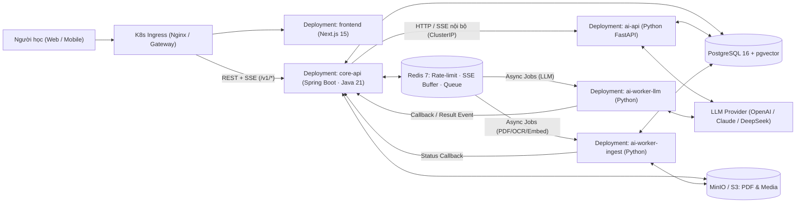

# Kiến trúc & Tech Stack Đề Xuất: Core Spring Boot + AI Engine Python trên Kubernetes

> **Trạng thái tài liệu:** `ACTIVE ARCHITECTURE` (Dự án cá nhân phi thương mại — đã triển khai Phase 0–8 + Thư viện Mở `L0–L6` + Đa phương thức `P0–P3`; còn chặng cuối Phase 10: Reel Engine + K8s).
> **Ngày tạo:** 2026-11-25 · **Cập nhật lần cuối:** 2026-11-27
> **Mục tiêu:** Đạt độ tương đồng trải nghiệm học tập 100% với PolySkill (AI Tutor "Sopi" 6 tools + SSE `Last-Event-ID`, Kho tri thức mở `491` giáo trình / `545k` chunks + `12,860` hình minh họa chuẩn hóa, RAG + OCR, FSRS/Mastery, Narrated Reels; **không tích hợp Billing/Paywall thương mại**), chạy chuẩn trên **Kubernetes (K8s)** nhưng **tránh bẫy over-engineering của microservice nhỏ lẻ**.

---

## 1. Triết lý kiến trúc: Vì sao chọn 2-Service Polyglot thay vì Microservices?

| Tiêu chí | Microservices (8–12 services) | **2-Service Polyglot (Đề xuất)** |
|---|---|---|
| **Độ phức tạp nghiệp vụ** | Phải dùng Saga/Outbox cho 1 thao tác nộp bài chạm `Attempt + XP + Streak + Mastery + FSRS + Milestone` | Gọn trong **1 ACID transaction PostgreSQL** ở `core-api` |
| **Khai thác thế mạnh ngôn ngữ** | Phức tạp quản lý nhiều repo/runtime | **Java/Spring Boot** cho lõi nghiệp vụ chặt chẽ + **Python** cho AI/LLM/OCR/RAG |
| **Triển khai Kubernetes** | Quá nhiều manifest, service mesh, khó debug | **3–5 Deployments** gọn gàng, scale độc lập theo từng loại tải (HTTP / SSE / LLM Queue / OCR CPU) |
| **Phù hợp với SopiSkill** | Không nên ở giai đoạn solo/team nhỏ | Rất phù hợp cho cả **production thực tế** lẫn **đồ án / portfolio Java + AI + K8s** |

---

## 2. Sơ đồ kiến trúc tổng thể



---

## 3. Chi tiết Tech Stack theo từng lớp

### 3.1 Frontend (Giữ nguyên nền tảng SopiSkill hiện tại)
- **Framework:** Next.js 15 (App Router), React 19, TypeScript.
- **Data Fetching & Cache:** TanStack Query.
- **Giao tiếp:** Chỉ gọi duy nhất **1 API Gateway là `core-api`** qua REST JSON + SSE (`fetch` stream hỗ trợ `Last-Event-ID`).
- **Tùy chọn mở rộng Mobile sau này:** Có thể tái sử dụng cùng `/v1/*` API contract nếu làm thêm Expo/React Native.

### 3.2 Service 1 — `core-api` (Spring Boot · Java 21+)
Chịu trách nhiệm **toàn bộ nghiệp vụ học tập, dữ liệu người dùng, bảo mật và điều phối**.

| Lớp | Công nghệ khuyên dùng | Vai trò |
|---|---|---|
| **Runtime & Framework** | **Java 21+ (LTS)** + **Spring Boot 3.4+** | Bật **Virtual Threads** (`spring.threads.virtual.enabled=true`) xử lý tốt đồng thời nhiều kết nối REST + SSE mà giữ code đồng bộ dễ đọc |
| **Web & SSE** | Spring Web MVC (`SseEmitter`) + `RestClient` / `WebClient` | Phục vụ REST API `/v1/*` và proxy luồng SSE từ `ai-api` về client |
| **Security & Auth** | Spring Security 6 + JWT (HttpOnly Cookie / Bearer) + OAuth2 Client (Google/Apple) + CSRF | Auth tập trung; khóa chặn quyền sở hữu `courseId`/`lessonId` trước mọi request |
| **Database & Migration** | PostgreSQL 16 + **Spring Data JPA / `JdbcClient`** + **Flyway** | **Chủ sở hữu duy nhất** của toàn bộ bảng nghiệp vụ (`core.*`) |
| **Cache, Rate-Limit & SSE Resume** | **Redis 7** (Lettuce + Sliding-Window Lua) | Rate-limiting đa pod (tách riêng bucket API/LLM và bucket media), idempotency cache, Redis Streams làm **SSE Event Buffer cho `Last-Event-ID`** |
| **LLM Budget & Abuse Guard** | Giới hạn an toàn kỹ thuật (`tutorMessagesPerDay`, `tutorTokensPerDay`, `maxConcurrentStreams`) | Mở 100% tính năng (không Paywall/Billing), nhưng giữ trần bảo vệ ngân sách LLM API cá nhân khỏi vòng lặp/spam |
| **Resilience & Observability** | **Resilience4j** (timeout, circuit breaker, retry) + **Spring Boot Actuator** + **Micrometer / OpenTelemetry** | Probes cho K8s (`/actuator/health/liveness`, `/actuator/health/readiness`), metrics Prometheus, distributed trace giữa SB ↔ Python |
| **API Contract** | **Springdoc OpenAPI 3** | Xuất `openapi.yaml` làm hợp đồng chuẩn với Frontend và `ai-engine` |

### 3.3 Service 2 — `ai-engine` (Python 3.12+)
Đóng gói **1 Docker image Python**, chạy thành 3 nhóm workload riêng trên K8s (`ai-api`, `ai-worker-llm`, `ai-worker-ingest`).

| Lớp | Công nghệ khuyên dùng | Vai trò |
|---|---|---|
| **Runtime & HTTP** | **Python 3.12+** + **FastAPI** + `uvicorn` + `pydantic v2` | Endpoint nội bộ cho tác vụ thời gian thực (Tutor SSE, Short-answer Grader, Interview turn) |
| **Worker Queue** | **ARQ / Celery / Redis Streams** (dùng chung Redis 7 hoặc RabbitMQ) | Tách riêng queue **LLM** (I/O-bound, chậm) và queue **Ingest/OCR** (CPU/RAM-bound) |
| **LLM & Agent Loop** | Official `openai` SDK (`AsyncOpenAI`) + Pydantic v2 + `MockProvider` | 8 Agent chuyên biệt: Source Research, Source Brief, Interview & Planner, Lesson Generator (`save_lesson` + 6 loại `figure`: `formula, table, visual, diagram, code, plot`), Validator QA (`flag_question`), Short-Answer Grader, Tutor "Sopi" (6 tools), và Reel Script *(Phase 10A)* |
| **Document, LaTeX & Figures** | **PyMuPDF (`fitz`)** + **`vietocr`** + arXiv HTML5 / CNXML / Vector BBox extractor | Trích xuất văn bản, công thức LaTeX (`$...$`, `$$...$$`), khối code, sinh `source.brief` và đăng ký hình minh họa gốc vào `rag.source_figures` |
| **Retrieval (Hybrid RAG)** | **`pgvector`** (trên PostgreSQL 16) + PostgreSQL Full-Text Search (BM25/tsvector) + RRF | Tìm kiếm kết hợp từ khóa + ngữ nghĩa trên cả PDF cá nhân lẫn kho mở `545k+` chunks (`PUBLIC_LIBRARY_OWNER_ID`), trả citation xác minh vị trí (`chunkId`, `pageNumber`, `sectionAnchor`) |
| **Audiovisual Reel (Phase 10A)** | `TTSProvider` trung lập + bộ biên dịch AST toán học an toàn dùng chung (`figure_validator.py`) | Tái sử dụng AST math whitelist (cấm `eval()`), KaTeX/Code primitives và `sourceFigureId` từ P0–P3 để xuất Audio Reels 2 pha |

### 3.4 Hạ tầng Dữ liệu & Lưu trữ

| Thành phần | Công nghệ | Ghi chú triển khai |
|---|---|---|
| **Relational + Vector DB** | **PostgreSQL 16** + extension **`pgvector`** | Tách schema cứng (`core.*` do **Flyway `V1..V8`** của `core-api` quản lý; `rag.*` gồm `document_chunks` + `source_figures` do **Alembic `0001..0004+`** của `ai-engine` quản lý) |
| **In-memory / Broker** | **Redis 7** (AOF persistence nhẹ) | Rate limit (tách riêng bucket API/LLM và bucket tải media), Idempotency key, SSE `Last-Event-ID` ring buffer (TTL 10 phút), Redis Streams (`queue:ai:llm`, `queue:ai:ingest`) |
| **Object Storage** | **MinIO** (local/K8s) hoặc **AWS S3 / Cloudflare R2** (prod) | Quy hoạch 3 nhánh prefix trong bucket: `sources/{sourceId}/...` (PDF upload qua Presigned PUT), `library-figures/{bookKey}/{figId}.webp` (`12,860+` ảnh giáo trình), và `reels-audio/{courseId}/{lessonId}/...` (TTS audio Phase 10A, tự dọn khi `regenerate_unit`) |

---

## 4. Phân ranh giới trách nhiệm (Domain Ownership Matrix)

Để không rơi vào tình trạng "Distributed Monolith" (2 service giẫm chân nhau sửa chung bảng), hệ thống tuân thủ ranh giới cứng sau:

| Nghiệp vụ / Dữ liệu | Chủ sở hữu | Ghi chú triển khai |
|---|---|---|
| Auth, Session, OAuth, CSRF, User, Profile, Settings | **`core-api` (SB)** | Toàn quyền đọc/ghi DB (`core.*`) |
| Course, Unit, Lesson, Proposal Versioning (Optimistic Lock), Glossary | **`core-api` (SB)** | `ai-engine` chỉ tạo nội dung JSON rồi trả về để `core-api` validate & persist |
| Public Library Catalog (`core.sources` `visibility='public'`), xếp hạng sư phạm 20 ngành & kiểm quyền truy cập ảnh | **`core-api` (SB)** | Dự án cá nhân phi thương mại nên dùng hợp lệ toàn bộ `491` giáo trình mở (`CC BY`, `CC BY-SA`, `CC BY-NC`, `arXiv`) kèm `attributions[]`; xác thực quyền tại `GET /v1/library/figures/{sourceId}/{figureId}` |
| Answer Key Privacy (`public_blocks` vs `solution`) & Deterministic Grading (`mc`, `blank`, `order`, `match`) | **`core-api` (SB)** | Server-authoritative tuyệt đối, không lộ đáp án ra Frontend hay Tutor |
| XP, Streak, Freeze, Hearts, Milestones, Learning Path, FSRS Spaced Repetition (`/review`) | **`core-api` (SB)** | Chạy gọn trong 1 DB transaction khi nộp bài |
| Tutor Thread metadata, Safety Allowance 24h, `ChangeCard` confirm/decline state machine | **`core-api` (SB)** | Quản lý vòng đời `pending → confirmed/declined → preparing → ready` + chặn spam LLM |
| LLM Orchestration (Interview, Proposal Revise, Lesson Gen, Validator QA, Regenerate Unit, Reel Script) | **`ai-engine` (Python)** | Stateless; kiểm tra đồ thị SVG + AST toán học an toàn (`figure_validator.py`) trước khi trả JSON về `core-api` |
| Short-Answer Semantic/LLM Rubric Grading + Dispute re-check | **`ai-engine` (Python)** | Nhận câu trả lời + rubric từ `core-api`, trả verdict + feedback |
| AI Tutor "Sopi" Reasoning + 6 Tools + SSE Token Generation | **`ai-engine` (Python)** | Chỉ nhận `public_blocks` (không bao giờ nhận đáp án quiz) |
| PDF/EPUB/arXiv Extraction, OCR (`vietocr`), Chunking, Hybrid RAG & Kho ảnh minh họa (`rag.source_figures`) | **`ai-engine` (Python)** | Quản lý schema `rag.document_chunks`, `rag.source_figures` (`Alembic`) và đối tượng ảnh/audio trên MinIO |

---

## 5. Các luồng giao tiếp chính giữa Spring Boot và Python

### 5.1 Luồng 1 — AI Tutor "Sopi" (SSE + `Last-Event-ID` đa pod)
1. Frontend gửi `POST /v1/courses/{courseId}/tutor/messages` (kèm `clientMessageId`, `threadId`, `entryPoint`, `contextRef`, và tùy chọn header `Last-Event-ID`) tới **`core-api`**.
2. **`core-api`** xác thực user, kiểm tra quyền sở hữu course/lesson, kiểm tra trần an toàn chống spam & concurrency lock, tạo `user_message` + `assistant_message (pending)` trong PostgreSQL.
3. Nếu có `Last-Event-ID`: **`core-api`** đọc lại các SSE frame còn trong **Redis Stream/Buffer** (`tutor:stream:{messageId}`, TTL ~5–10 phút) để phát tiếp; nếu buffer đã hết hạn thì phát event `restarted` / tải lại lịch sử từ DB.
4. Nếu lượt mới: **`core-api`** dựng ngữ cảnh an toàn (`public_blocks`, không answer key) và mở stream nội bộ tới `ai-api` (`POST /internal/tutor/stream`).
5. Mỗi frame (`delta`, `tool`, `confirm`, `citations`, `done`, `error`) từ Python đi qua **`core-api`** sẽ được:
   - Đánh số `id: <seq>` và ghi vào Redis buffer (cho `Last-Event-ID`).
   - Đẩy ngay xuống trình duyệt qua `SseEmitter`.
6. Khi user bấm **Dừng** (`POST .../stop`), request có thể rơi vào **bất kỳ pod `core-api` nào**: pod đó đặt cờ `cancel` vào DB + publish lên **Redis Pub/Sub**, pod đang giữ stream nhận tín hiệu và hủy stream sang Python ngay lập tức.

### 5.2 Luồng 2 — Sinh khóa học / Bài học / `regenerate_unit` (Async)
1. **`core-api`** tạo bản ghi job (`status = queued`, `idempotency_key`), đẩy message nhỏ `{jobId, courseId, type, payloadRef}` vào queue `queue:ai:llm`.
2. **`ai-worker-llm`** (Python) kéo job, chạy Agent Loop (Generator → Validator QA), kiểm tra token truncation & completeness lint.
3. Xong việc, worker gửi kết quả JSON về `core-api` (`POST /internal/jobs/{jobId}/complete` kèm `X-Internal-Token` + HMAC/secret).
4. **`core-api`** validate schema lần cuối, tách `public_blocks` & `answer_key`, lưu PostgreSQL trong 1 transaction và chuyển trạng thái `ready` (Frontend poll `2s`/`5s` tự cập nhật).

### 5.3 Luồng 3 — Ingest PDF / OCR, Đồng bộ Thư viện Mở & Phục vụ Ảnh Minh Họa
1. **Tài liệu cá nhân:** Frontend xin presigned URL từ **`core-api`** (`POST /v1/sources/upload`) → `PUT` PDF thẳng lên **MinIO/S3** (`sources/...`, không đẩy file 25 MB qua RAM của `core-api`) → gọi `POST /v1/sources/{id}/ingest` đẩy job vào `queue:ai:ingest`. **`ai-worker-ingest`** tải file từ S3, chạy PyMuPDF / `vietocr`, tạo `source.brief` + chunks + embeddings lưu vào `rag.document_chunks`, rồi callback báo `ready` cho **`core-api`**.
2. **Thư viện Giáo trình Mở & Ảnh gốc:** Pipeline đồng bộ đẩy metadata sách qua `POST /internal/library/sources/upsert` (trên `core-api`), ghi chunks sạch vào `rag.document_chunks` (`owner_id = 'system:public_library'`) và đẩy ảnh WebP lên MinIO (`library-figures/...`) kèm bản ghi `rag.source_figures`.
3. **Phục vụ ảnh minh họa (`sourceFigureId`):** Frontend gọi `GET /v1/library/figures/{sourceId}/{figureId}` (bucket rate-limit riêng cho media). **`core-api`** kiểm tra quyền truy cập nguồn (`owner_id = user` hoặc `visibility = 'public'`), sau đó ủy quyền qua `/internal/library/figures/{sourceId}/{figureId}` kèm `Cache-Control: private, max-age=86400` + `X-Content-Type-Options: nosniff` *(hoặc ở quy mô tải lớn trên K8s/Cloud, trả `302` / Presigned `GET` URL ngắn hạn trỏ thẳng tới S3/R2/CDN để giải phóng băng thông khỏi RAM của `core-api` và `ai-api`)*.

### 5.4 Bảo mật giao tiếp nội bộ
- `ai-api` chỉ expose qua Kubernetes **`ClusterIP`** (không có Ingress công khai ra Internet).
- Mọi lời gọi `core-api ↔ ai-engine` đều mang header `X-Internal-Service-Token` + chữ ký HMAC (`X-Internal-Timestamp`, `X-Internal-Signature`) và `X-Correlation-Id` để truy vết log xuyên service.

---

## 6. Blueprint Triển khai trên Kubernetes (K8s)

### 6.1 Danh sách Workload & Cấu hình Scale

| K8s Resource | Image | Replicas (gợi ý) | Cơ chế Scale | Tài nguyên gợi ý (req / lim & PVC) |
|---|---|---|---|---|
| `Deployment: frontend` | `sopiskill-frontend` | `2` | HPA (CPU 70%) | `100m / 500m` CPU · `256Mi / 512Mi` RAM |
| `Deployment: core-api` | `sopiskill-core-sb` | `2–6` | HPA (CPU / Active requests) | `500m / 1500m` CPU · `512Mi / 1Gi` RAM |
| `Deployment: ai-api` | `sopiskill-ai-py` | `2–4` | HPA (Concurrency / CPU) | `250m / 1000m` CPU · `512Mi / 1Gi` RAM |
| `Deployment: ai-worker-llm` | `sopiskill-ai-py` | `1–6` | **KEDA** theo độ dài `queue:ai:llm` | `250m / 1000m` CPU · `512Mi / 1Gi` RAM |
| `Deployment: ai-worker-ingest` | `sopiskill-ai-py` | `1–4` | **KEDA** theo độ dài `queue:ai:ingest` | `1000m / 2000m` CPU · `1Gi / 2Gi` RAM *(OCR nặng)* |
| `StatefulSet / CNPG: pgvector-db` | `pgvector/pgvector:pg16` | `1` (+ read replica prod) | Stateful PVC | `1000m / 2000m` CPU · **`2Gi / 4Gi` RAM** (`shared_buffers >= 1GB` giữ nóng HNSW/GIN cho `545k+` chunks) · **PVC `>= 20Gi`** |
| `StatefulSet: minio` *(on-prem/dev)* | `minio/minio` | `1` (hoặc S3/R2 prod) | Stateful PVC | `250m / 1000m` CPU · `512Mi / 1Gi` RAM · **PVC `>= 20Gi`** (`12,860+` ảnh WebP + PDF + Reel audio) |
| `Job: core-db-migrate` | `sopiskill-core-sb` + `ai-py` | `1` (pre-upgrade) | Helm hook / InitJob | Chạy Flyway (`core` `V1..V8`) + Alembic (`rag` `0001..0004+`) |
| `Job: library-seed` *(tùy chọn)* | `sopiskill-ai-py` | `1` (khởi tạo cụm mới) | Manual / Post-install Job | Khôi phục dump hoặc đồng bộ danh mục `491` sách mở + mirror `library-figures/` vào MinIO |
| `CronJob: maintenance` | `sopiskill-core-sb` | Theo lịch | Daily / Hourly | Dọn stale streams, dọn `reels-audio/` mồ côi, backup DB SHA-256, chốt hạng League, nhắc streak |

### 6.2 Cấu hình K8s bắt buộc cho SopiSkill

1. **Tách 2 Ingress Rules (SSE không buffer vs. REST & Media có buffer/cache):**
   - **Ingress 1 — Đường dẫn SSE thời gian thực (`/v1/courses/.*/tutor/.*`):**
     ```yaml
     metadata:
       name: sopiskill-tutor-sse-ingress
       annotations:
         nginx.ingress.kubernetes.io/use-regex: "true"
         nginx.ingress.kubernetes.io/proxy-buffering: "off"
         nginx.ingress.kubernetes.io/proxy-read-timeout: "300"
         nginx.ingress.kubernetes.io/proxy-send-timeout: "300"
     ```
   - **Ingress 2 — Đường dẫn REST API & Ảnh/Media (`/v1/*`, `/v1/library/figures/*`):**
     ```yaml
     metadata:
       name: sopiskill-api-media-ingress
       annotations:
         nginx.ingress.kubernetes.io/proxy-buffering: "on"
         nginx.ingress.kubernetes.io/proxy-body-size: "30m"
     ```
2. **Health Probes:**
   - `core-api`: `livenessProbe` → `/actuator/health/liveness`, `readinessProbe` → `/actuator/health/readiness` (kiểm tra cả kết nối PostgreSQL + Redis).
   - `ai-api`: `readinessProbe` → `/ready` (kiểm tra cấu hình provider + DB/Redis).
3. **Graceful Shutdown:**
   - `core-api`: `server.shutdown=graceful` + `terminationGracePeriodSeconds: 60` để xả nốt SSE đang stream.
   - `ai-worker-llm` & `ai-worker-ingest`: `terminationGracePeriodSeconds: 120` để không cắt ngang bài học/reel đang sinh hoặc file PDF đang OCR.
4. **Config & Secrets:**
   - Dùng `ConfigMap` cho cờ tính năng (`REEL_ENABLED`, `RAG_ENABLED`, `OCR_ENABLED`, `TUTOR_ENABLED`, `HEARTS_ENFORCEMENT_ENABLED`, `LEAGUES_ENABLED`).
   - Dùng Kubernetes `Secret` (hoặc External Secrets Operator / Sealed Secrets) cho DB password, JWT signing key, LLM API keys, `INTERNAL_SERVICE_TOKEN` và `INTERNAL_HMAC_SECRET`.
5. **Stateful Services (PostgreSQL, Redis, S3):**
   - **Production:** Dùng Managed Services (RDS/Cloud SQL + `pgvector` tối thiểu `4 GB` RAM, Managed Redis, AWS S3 / Cloudflare R2 kèm Presigned URL cho media).
   - **Dev / Đồ án / On-prem K8s:** Dùng **CloudNativePG** (`pgvector:pg16`, PVC `>= 20Gi`), Redis chart và MinIO (PVC `>= 20Gi`).

---

## 7. Cấu trúc thư mục Monorepo đề xuất

```text
sopiskill/
├── contracts/                  # OpenAPI + JSON Schema chung giữa SB, Python & FE
│   ├── public-api.yaml         # Contract FE <-> core-api (/v1/*)
│   └── internal-ai.yaml        # Contract core-api <-> ai-engine (/internal/*)
├── frontend/                   # Next.js 15 (giữ nguyên repo hiện tại)
├── core-api/                   # Spring Boot 3.4+ (Java 21, Maven, Flyway V1..V8)
│   └── src/main/java/com/sopiskill/core/
│       ├── auth/
│       ├── course/
│       ├── lesson/
│       ├── review/             # FSRS + Mastery + Gamification
│       ├── sources/            # User PDF + Public Library Discovery + Figure Proxy
│       ├── tutor/              # SSE Gateway + Last-Event-ID + ChangeCard state
│       └── internal/           # Client gọi ai-engine + HMAC callback endpoints
├── ai-engine/                  # Python 3.12+
│   ├── app/
│   │   ├── api/                # FastAPI endpoints nội bộ (tutor stream, grade, figures)
│   │   ├── workers/            # worker_llm.py, worker_ingest.py
│   │   ├── agents/             # 8 specialized agents + figure_validator.py
│   │   └── rag/                # extractor, vietocr, source_figures, hybrid_search
└── deploy/
    ├── docker-compose.yml      # Chạy local nhanh (8 containers)
    └── k8s/                    # Helm chart (HPA + KEDA + Split Ingress)
```

---

## 8. Lộ trình chuyển đổi thực tế từ SopiSkill (Strangler Fig — Đã hoàn tất Bước 1–3)

1. **Bước 1 — Đóng băng hợp đồng (`/v1/*`):** Chốt OpenAPI cho toàn bộ endpoint FE đang gọi (bao gồm Wave 4, Tutor 6 tools + `Last-Event-ID`).
2. **Bước 2 — Giữ nguyên lớp AI/RAG/OCR Python làm `ai-engine`:** Đưa 8 Agent, Hybrid RAG (`pgvector` + FTS), OCR và kho ảnh `rag.source_figures` ra `/internal/*` + 2 Redis Streams workers.
3. **Bước 3 — Dựng `core-api` (Spring Boot) theo từng module:**
   - Đợt 1: Auth (OAuth2 + Refresh Session) + User/Profile/Settings + Flyway + Actuator/K8s probes.
   - Đợt 2: Course + Proposal + Lesson + Attempt/XP/Streak/Hearts + FSRS Review.
   - Đợt 3: Tutor SSE Gateway (`Last-Event-ID` qua Redis + Pub/Sub `stop`) + `ChangeCard` confirm gate + Open Library Discovery (`491` sách, `12,860` ảnh).
4. **Bước 4 — Narrated Reels & Đóng gói Kubernetes (Phase 10):** Bổ sung 2-Phase Reel Engine (`Flyway V8`) và đóng gói Helm chart trên `kind` / `k3s` local, verify Playwright E2E + Chaos test đa pod.

---

## 9. Đối chiếu nhanh với PolySkill

| Thành phần | PolySkill (`OBSERVED_STATIC`) | SopiSkill (Kiến trúc đề xuất này) |
|---|---|---|
| **Frontend** | Expo SDK 57 + RN Web + Zustand + TanStack Query | Next.js 15 + TanStack Query (cùng thiết kế UI/UX A–Z) |
| **Core Backend** | 1 API Gateway `/v1` (khả năng cao Node/TS monorepo) | **Spring Boot (Java 21+)** — 1 API Gateway `/v1` |
| **AI & Document Engine** | 7 Agent/Pipeline phía server | **Python FastAPI + 2 Workers** (LLM & Ingest/OCR/RAG) |
| **Shared Contracts** | `@polyskill/shared` (Zod v4) | `contracts/` (OpenAPI 3 + JSON Schema) |
| **Database & Queue** | Ẩn phía server (`UNKNOWN`) | PostgreSQL 16 + `pgvector` + Redis 7 + MinIO/S3 |
| **Orchestration** | Ẩn phía server (`UNKNOWN`) | **Kubernetes** (HPA + KEDA + Ingress SSE + Helm) |
