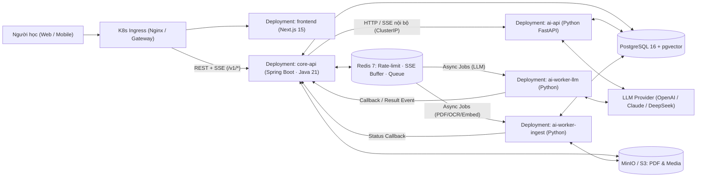

# Kiến trúc & Tech Stack Đề Xuất: Core Spring Boot + AI Engine Python trên Kubernetes

> **Trạng thái tài liệu:** `PROPOSAL` (Kiến trúc mục tiêu tham chiếu từ bản reverse PolySkill ngày 2026-11-22 và codebase SopiSkill hiện tại).
> **Ngày tạo:** 2026-11-25
> **Mục tiêu:** Đạt độ tương đồng tính năng 100% với PolySkill (bao gồm AI Tutor "Sopi" 6 tools + SSE `Last-Event-ID`, Billing Polar.sh + SePay VietQR, Entitlement Free/Pro, RAG + OCR, FSRS/Mastery), chạy chuẩn trên **Kubernetes (K8s)** nhưng **tránh bẫy over-engineering của microservice nhỏ lẻ**.

---

## 1. Triết lý kiến trúc: Vì sao chọn 2-Service Polyglot thay vì Microservices?

| Tiêu chí | Microservices (8–12 services) | **2-Service Polyglot (Đề xuất)** |
|---|---|---|
| **Độ phức tạp nghiệp vụ** | Phải dùng Saga/Outbox cho 1 thao tác nộp bài chạm `Attempt + XP + Streak + Mastery + FSRS + Milestone + Entitlement` | Gọn trong **1 ACID transaction PostgreSQL** ở `core-api` |
| **Khai thác thế mạnh ngôn ngữ** | Phức tạp quản lý nhiều repo/runtime | **Java/Spring Boot** cho lõi nghiệp vụ chặt chẽ + **Python** cho AI/LLM/OCR/RAG |
| **Triển khai Kubernetes** | Quá nhiều manifest, service mesh, khó debug | **3–5 Deployments** gọn gàng, scale độc lập theo từng loại tải (HTTP / SSE / LLM Queue / OCR CPU) |
| **Phù hợp với SopiSkill** | Không nên ở giai đoạn solo/team nhỏ | Rất phù hợp cho cả **production thực tế** lẫn **đồ án / portfolio Java + AI + K8s** |

---

## 2. Sơ đồ kiến trúc tổng thể



---

## 3. Chi tiết Tech Stack theo từng lớp

### 3.1 Frontend (Giữ nguyên nền tảng SopiSkill hiện tại)
- **Framework:** Next.js 15 (App Router), React 19, TypeScript.
- **Data Fetching & Cache:** TanStack Query.
- **Giao tiếp:** Chỉ gọi duy nhất **1 API Gateway là `core-api`** qua REST JSON + SSE (`fetch` stream hỗ trợ `Last-Event-ID`).
- **Tùy chọn mở rộng Mobile sau này:** Có thể tái sử dụng cùng `/v1/*` API contract nếu làm thêm Expo/React Native.

### 3.2 Service 1 — `core-api` (Spring Boot · Java 21+)
Chịu trách nhiệm **toàn bộ nghiệp vụ, dữ liệu người dùng, bảo mật, thanh toán và điều phối**.

| Lớp | Công nghệ khuyên dùng | Vai trò |
|---|---|---|
| **Runtime & Framework** | **Java 21+ (LTS)** + **Spring Boot 3.4+** | Bật **Virtual Threads** (`spring.threads.virtual.enabled=true`) xử lý tốt đồng thời nhiều kết nối REST + SSE mà giữ code đồng bộ dễ đọc |
| **Web & SSE** | Spring Web MVC (`SseEmitter`) + `RestClient` / `WebClient` | Phục vụ REST API `/v1/*` và proxy luồng SSE từ `ai-api` về client |
| **Security & Auth** | Spring Security 6 + JWT (HttpOnly Cookie / Bearer) + OAuth2 Client (Google/Apple) + CSRF | Auth tập trung; khóa chặn quyền sở hữu `courseId`/`lessonId` trước mọi request |
| **Database & Migration** | PostgreSQL 16 + **Spring Data JPA** (hoặc **jOOQ** cho query báo cáo phức tạp) + **Flyway** | **Chủ sở hữu duy nhất** của toàn bộ bảng nghiệp vụ |
| **Cache, Rate-Limit & SSE Resume** | **Redis 7** (Lettuce / Redisson + Bucket4j) | Rate-limiting đa pod, idempotency cache, Redis Streams/List làm **SSE Event Buffer cho `Last-Event-ID`** |
| **Billing & Entitlement** | Adapter nội bộ cho **Polar.sh** (Checkout + Webhook) & **SePay VietQR** (Order + Webhook/Poll) + `MockBillingProvider` | Quản lý gói Free/Pro, kiểm soát giới hạn khóa/unit/tutor bằng feature flag (`BILLING_ENFORCEMENT_ENABLED`) |
| **Resilience & Observability** | **Resilience4j** (timeout, circuit breaker, retry) + **Spring Boot Actuator** + **Micrometer / OpenTelemetry** | Probes cho K8s (`/actuator/health/liveness`, `/actuator/health/readiness`), metrics Prometheus, distributed trace giữa SB ↔ Python |
| **API Contract** | **Springdoc OpenAPI 3** | Xuất `openapi.yaml` làm hợp đồng chuẩn với Frontend và `ai-engine` |

### 3.3 Service 2 — `ai-engine` (Python 3.12+)
Đóng gói **1 Docker image Python**, chạy thành 3 nhóm workload riêng trên K8s (`ai-api`, `ai-worker-llm`, `ai-worker-ingest`).

| Lớp | Công nghệ khuyên dùng | Vai trò |
|---|---|---|
| **Runtime & HTTP** | **Python 3.12+** + **FastAPI** + `uvicorn` + `pydantic v2` | Endpoint nội bộ cho tác vụ thời gian thực (Tutor SSE, Short-answer Grader, Interview turn) |
| **Worker Queue** | **ARQ / Celery / Redis Streams** (dùng chung Redis 7 hoặc RabbitMQ) | Tách riêng queue **LLM** (I/O-bound, chậm) và queue **Ingest/OCR** (CPU/RAM-bound) |
| **LLM & Agent Loop** | OpenAI-compatible SDK (`httpx`/`openai`) + Pydantic structured output + `MockProvider` | Interview & Proposal Agent (`revise_proposal`), Lesson Generator Agent Loop (`save_lesson`, `regenerate_unit`), Validator QA Agent (`flag_question`), Tutor "Sopi" (6 tools) |
| **Document & OCR** | **PyMuPDF (`fitz`)** + **`vietocr`** (PDF scan tiếng Việt) + arXiv/Web extractor | Trích xuất văn bản, sinh `source.brief` có cấu trúc (claims, sections, anchors) |
| **Retrieval (Hybrid RAG)** | **`pgvector`** (trên PostgreSQL 16) + PostgreSQL Full-Text Search (BM25/tsvector) + RRF | Tìm kiếm kết hợp từ khóa + ngữ nghĩa, trả citation đã xác minh vị trí (`chunkId`, `pageNumber`, `sectionAnchor`) |
| **Mở rộng tương lai** | TTS adapter + Math/Plot deterministic compiler | Nếu sau này triển khai Audio Reels 2 pha giống PolySkill |

### 3.4 Hạ tầng Dữ liệu & Lưu trữ

| Thành phần | Công nghệ | Ghi chú triển khai |
|---|---|---|
| **Relational + Vector DB** | **PostgreSQL 16** + extension **`pgvector`** | Tách schema logic (`core.*` do Flyway quản lý; `rag.*` cho chunks/embeddings của Python) |
| **In-memory / Broker** | **Redis 7** (AOF persistence nhẹ) | Rate limit, Idempotency key, SSE `Last-Event-ID` ring buffer (TTL 5–10 phút), Job queue |
| **Object Storage** | **MinIO** (local/K8s) hoặc **AWS S3 / Cloudflare R2** (prod) | Lưu PDF upload (qua Presigned URL từ `core-api`) và audio/media |

---

## 4. Phân ranh giới trách nhiệm (Domain Ownership Matrix)

Để không rơi vào tình trạng "Distributed Monolith" (2 service giẫm chân nhau sửa chung bảng), hệ thống tuân thủ ranh giới cứng sau:

| Nghiệp vụ / Dữ liệu | Chủ sở hữu | Ghi chú triển khai |
|---|---|---|
| Auth, Session, OAuth, CSRF, User, Profile, Settings | **`core-api` (SB)** | Toàn quyền đọc/ghi DB |
| Course, Unit, Lesson, Proposal Versioning (Optimistic Lock), Glossary | **`core-api` (SB)** | `ai-engine` chỉ tạo nội dung JSON rồi trả về để `core-api` validate & persist |
| Answer Key Privacy (`public_blocks` vs `solution`) & Deterministic Grading (`mc`, `blank`, `order`, `match`) | **`core-api` (SB)** | Server-authoritative tuyệt đối, không lộ đáp án ra Frontend hay Tutor |
| XP, Streak, Freeze, Milestones, Learning Path, FSRS Spaced Repetition (`/review`) | **`core-api` (SB)** | Chạy gọn trong 1 DB transaction khi nộp bài |
| Entitlement (Free/Pro), Quota, Billing (Polar.sh + SePay VietQR), Webhooks | **`core-api` (SB)** | Chặn quota trước khi chuyển tiếp sang `ai-engine` |
| Tutor Thread metadata, Allowance 24h, `ChangeCard` confirm/decline state machine | **`core-api` (SB)** | Quản lý vòng đời `pending → confirmed/declined → preparing → ready` |
| LLM Orchestration (Interview, Proposal Revise, Lesson Gen, Validator QA, Regenerate Unit) | **`ai-engine` (Python)** | Stateless; nhận payload + context từ `core-api`, trả JSON hợp lệ theo schema |
| Short-Answer Semantic/LLM Rubric Grading + Dispute re-check | **`ai-engine` (Python)** | Nhận câu trả lời + rubric từ `core-api`, trả verdict + feedback |
| AI Tutor "Sopi" Reasoning + 6 Tools + SSE Token Generation | **`ai-engine` (Python)** | Chỉ nhận `public_blocks` (không bao giờ nhận đáp án quiz) |
| PDF/Web/arXiv Extraction, OCR (`vietocr`), Chunking, Embedding, Hybrid RAG | **`ai-engine` (Python)** | Quản lý schema `rag.document_chunks` & vector index |

---

## 5. Các luồng giao tiếp chính giữa Spring Boot và Python

### 5.1 Luồng 1 — AI Tutor "Sopi" (SSE + `Last-Event-ID` đa pod)
1. Frontend gửi `POST /v1/courses/{courseId}/tutor/messages` (kèm `clientMessageId`, `threadId`, `entryPoint`, `contextRef`, và tùy chọn header `Last-Event-ID`) tới **`core-api`**.
2. **`core-api`** xác thực user, kiểm tra quyền sở hữu course/lesson, kiểm tra quota Free/Pro & concurrency lock, tạo `user_message` + `assistant_message (pending)` trong PostgreSQL.
3. Nếu có `Last-Event-ID`: **`core-api`** đọc lại các SSE frame còn trong **Redis Stream/Buffer** (`tutor:stream:{messageId}`, TTL ~5–10 phút) để phát tiếp; nếu buffer đã hết hạn thì phát event `restarted` / tải lại lịch sử từ DB.
4. Nếu lượt mới: **`core-api`** dựng ngữ cảnh an toàn (`public_blocks`, không answer key) và mở stream nội bộ tới `ai-api` (`POST /internal/tutor/stream`).
5. Mỗi frame (`delta`, `tool`, `confirm`, `citations`, `done`, `error`) từ Python đi qua **`core-api`** sẽ được:
   - Đánh số `id: <seq>` và ghi vào Redis buffer (cho `Last-Event-ID`).
   - Đẩy ngay xuống trình duyệt qua `SseEmitter`.
6. Khi user bấm **Dừng** (`POST .../stop`), request có thể rơi vào **bất kỳ pod `core-api` nào**: pod đó đặt cờ `cancel` vào DB + publish lên **Redis Pub/Sub**, pod đang giữ stream nhận tín hiệu và hủy stream sang Python ngay lập tức.

### 5.2 Luồng 2 — Sinh khóa học / Bài học / `regenerate_unit` (Async)
1. **`core-api`** tạo bản ghi job (`status = queued`, `idempotency_key`), đẩy message nhỏ `{jobId, courseId, type, payloadRef}` vào queue `queue:ai:llm`.
2. **`ai-worker-llm`** (Python) kéo job, chạy Agent Loop (Generator → Validator QA), kiểm tra token truncation & completeness lint.
3. Xong việc, worker gửi kết quả JSON về `core-api` (`POST /internal/jobs/{jobId}/complete` kèm `X-Internal-Token` + HMAC/secret).
4. **`core-api`** validate schema lần cuối, tách `public_blocks` & `answer_key`, lưu PostgreSQL trong 1 transaction và chuyển trạng thái `ready` (Frontend poll `2s`/`5s` tự cập nhật).

### 5.3 Luồng 3 — Ingest PDF / OCR / RAG
1. Frontend xin presigned URL từ **`core-api`** (`POST /v1/sources/upload`) → `PUT` PDF thẳng lên **MinIO/S3** (không đẩy file 25 MB qua RAM của `core-api`).
2. Frontend gọi `POST /v1/sources/{id}/ingest` → **`core-api`** đẩy job vào `queue:ai:ingest`.
3. **`ai-worker-ingest`** tải file từ S3, chạy PyMuPDF / `vietocr`, tạo `source.brief` + chunks + embeddings lưu vào `rag.document_chunks` (`pgvector`), rồi callback báo `ready` cho **`core-api`**.

### 5.4 Bảo mật giao tiếp nội bộ
- `ai-api` chỉ expose qua Kubernetes **`ClusterIP`** (không có Ingress công khai ra Internet).
- Mọi lời gọi `core-api ↔ ai-engine` đều mang header `X-Internal-Service-Token` (hoặc mTLS bằng Istio/Linkerd nếu lên cụm lớn) và `X-Correlation-Id` để truy vết log xuyên service.

---

## 6. Blueprint Triển khai trên Kubernetes (K8s)

### 6.1 Danh sách Workload & Cấu hình Scale

| K8s Resource | Image | Replicas (gợi ý) | Cơ chế Scale | Tài nguyên gợi ý (req / lim) |
|---|---|---|---|---|
| `Deployment: frontend` | `sopiskill-frontend` | `2` | HPA (CPU 70%) | `100m / 500m` CPU · `256Mi / 512Mi` RAM |
| `Deployment: core-api` | `sopiskill-core-sb` | `2–6` | HPA (CPU / Active requests) | `500m / 1500m` CPU · `512Mi / 1Gi` RAM |
| `Deployment: ai-api` | `sopiskill-ai-py` | `2–4` | HPA (Concurrency / CPU) | `250m / 1000m` CPU · `512Mi / 1Gi` RAM |
| `Deployment: ai-worker-llm` | `sopiskill-ai-py` | `1–6` | **KEDA** theo độ dài `queue:ai:llm` | `250m / 1000m` CPU · `512Mi / 1Gi` RAM |
| `Deployment: ai-worker-ingest` | `sopiskill-ai-py` | `1–4` | **KEDA** theo độ dài `queue:ai:ingest` | `1000m / 2000m` CPU · `1Gi / 2Gi` RAM *(OCR nặng)* |
| `Job: core-db-migrate` | `sopiskill-core-sb` | `1` (pre-upgrade) | Helm hook / InitJob | `250m` CPU · `512Mi` RAM |
| `CronJob: maintenance` | `sopiskill-core-sb` | Theo lịch | Daily / Hourly | Dọn stale streams, backup DB, nhắc streak |

### 6.2 Cấu hình K8s bắt buộc cho SopiSkill

1. **Ingress cho SSE Tutor (Nginx Ingress annotations):**
   ```yaml
   metadata:
     annotations:
       nginx.ingress.kubernetes.io/proxy-buffering: "off"
       nginx.ingress.kubernetes.io/proxy-read-timeout: "300"
       nginx.ingress.kubernetes.io/proxy-send-timeout: "300"
       nginx.ingress.kubernetes.io/proxy-body-size: "30m"
   ```
2. **Health Probes:**
   - `core-api`: `livenessProbe` → `/actuator/health/liveness`, `readinessProbe` → `/actuator/health/readiness` (kiểm tra cả kết nối PostgreSQL + Redis).
   - `ai-api`: `readinessProbe` → `/ready` (kiểm tra cấu hình provider + DB/Redis).
3. **Graceful Shutdown:**
   - `core-api`: `server.shutdown=graceful` + `terminationGracePeriodSeconds: 60` để xả nốt SSE đang stream.
   - `ai-worker-llm` & `ai-worker-ingest`: `terminationGracePeriodSeconds: 120` để không cắt ngang bài học đang sinh hoặc file PDF đang OCR.
4. **Config & Secrets:**
   - Dùng `ConfigMap` cho cờ tính năng (`BILLING_ENFORCEMENT_ENABLED`, `RAG_ENABLED`, `OCR_ENABLED`, `TUTOR_ENABLED`).
   - Dùng Kubernetes `Secret` (hoặc External Secrets Operator / Sealed Secrets) cho DB password, JWT signing key, LLM API keys, Polar/SePay webhook secrets và `INTERNAL_SERVICE_TOKEN`.
5. **Stateful Services (PostgreSQL, Redis, S3):**
   - **Production:** Dùng Managed Services (RDS/Cloud SQL + pgvector, Managed Redis, S3/R2).
   - **Dev / Đồ án / On-prem K8s:** Dùng **CloudNativePG** (PostgreSQL), Bitnami Redis chart và MinIO Operator.

---

## 7. Cấu trúc thư mục Monorepo đề xuất

```text
sopiskill/
├── contracts/                  # OpenAPI + JSON Schema chung giữa SB, Python & FE
│   ├── public-api.yaml         # Contract FE <-> core-api (/v1/*)
│   └── internal-ai.yaml        # Contract core-api <-> ai-engine (/internal/*)
├── frontend/                   # Next.js 15 (giữ nguyên repo hiện tại)
├── core-api/                   # Spring Boot 3.4+ (Java 21, Gradle/Maven, Flyway)
│   └── src/main/java/com/sopiskill/
│       ├── auth/
│       ├── course/
│       ├── lesson/
│       ├── review/             # FSRS + Mastery
│       ├── tutor/              # SSE Gateway + Last-Event-ID + ChangeCard state
│       ├── billing/            # Entitlement + Polar + SePay + MockBilling
│       └── internal/           # Client gọi ai-engine + callback endpoints
├── ai-engine/                  # Python 3.12+ (tái sử dụng từ backend/ hiện tại)
│   ├── app/
│   │   ├── api/internal/       # FastAPI endpoints nội bộ (tutor stream, grade, interview)
│   │   ├── workers/            # worker_llm.py, worker_ingest.py
│   │   ├── agents/             # planner, generator, validator, tutor (6 tools)
│   │   └── rag/                # extractor, vietocr, chunker, hybrid_search
└── deploy/
    ├── docker-compose.yml      # Chạy local nhanh
    └── k8s/                    # Helm chart hoặc Kustomize (base + overlays/dev,prod)
```

---

## 8. Lộ trình chuyển đổi thực tế từ SopiSkill hiện tại (Strangler Fig)

Nếu muốn chuyển dần từ repo SopiSkill hiện tại (100% Python FastAPI) sang kiến trúc này **mà không phải vứt bỏ công sức đã làm**:

1. **Bước 1 — Đóng băng hợp đồng (`/v1/*`):** Chốt OpenAPI cho toàn bộ endpoint FE đang gọi (bao gồm Wave 4, Tutor 6 tools + `Last-Event-ID`, Billing Polar/SePay).
2. **Bước 2 — Giữ nguyên lớp AI/RAG/OCR Python làm `ai-engine`:** Tách các service trong `backend/app/services/` (`llm`, `tutor_*`, `rag_service`, `ocr`, `generation`, `validation`) ra endpoint nội bộ `/internal/*` và 2 worker queues.
3. **Bước 3 — Dựng `core-api` (Spring Boot) theo từng module:**
   - Đợt 1: Auth + User/Profile/Settings + Flyway baseline + Actuator/K8s probes.
   - Đợt 2: Course + Proposal + Lesson + Attempt/XP/Streak + FSRS Review.
   - Đợt 3: Tutor SSE Gateway (`Last-Event-ID` qua Redis) + `ChangeCard` confirm gate + Sources metadata/Presigned URL.
   - Đợt 4: Entitlement Free/Pro + Billing (Polar.sh + SePay VietQR + `MockBillingProvider`).
4. **Bước 4 — Đóng gói Kubernetes:** Chạy thử trên `kind` / `k3s` local với Helm chart, verify toàn bộ bộ Playwright E2E ([core-flow.spec.ts](file:///home/nguyenhuu/Hoc%20Tap/Reverse%20Engineer/frontend/e2e/core-flow.spec.ts)) và kiểm thử rolling update giữa lúc đang stream SSE Tutor.

---

## 9. Đối chiếu nhanh với PolySkill

| Thành phần | PolySkill (`OBSERVED_STATIC`) | SopiSkill (Kiến trúc đề xuất này) |
|---|---|---|
| **Frontend** | Expo SDK 57 + RN Web + Zustand + TanStack Query | Next.js 15 + TanStack Query (cùng thiết kế UI/UX A–Z) |
| **Core Backend** | 1 API Gateway `/v1` (khả năng cao Node/TS monorepo) | **Spring Boot (Java 21+)** — 1 API Gateway `/v1` |
| **AI & Document Engine** | 7 Agent/Pipeline phía server | **Python FastAPI + 2 Workers** (LLM & Ingest/OCR/RAG) |
| **Shared Contracts** | `@polyskill/shared` (Zod v4) | `contracts/` (OpenAPI 3 + JSON Schema) |
| **Database & Queue** | Ẩn phía server (`UNKNOWN`) | PostgreSQL 16 + `pgvector` + Redis 7 + MinIO/S3 |
| **Orchestration** | Ẩn phía server (`UNKNOWN`) | **Kubernetes** (HPA + KEDA + Ingress SSE + Helm) |
