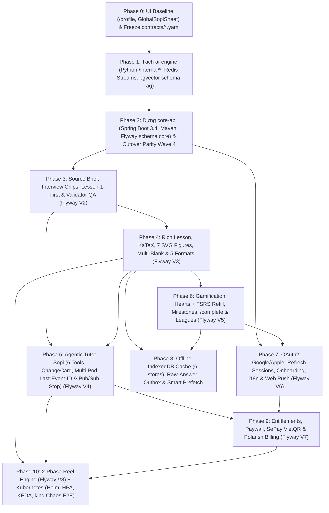

# Kế hoạch Tổng thể SopiSkill: Kiến trúc Spring Boot + Python AI trên Kubernetes (Phase 0 → Phase 10)

> **Tài liệu tham chiếu gốc:**
> - Báo cáo đối chiếu tính năng: [polyskill-analysis-report.md](file:///home/nguyenhuu/Hoc%20Tap/Reverse%20Engineer/polyskill-analysis-report.md)
> - Kiến trúc mục tiêu: [spring-boot-python-k8s-architecture.md](file:///home/nguyenhuu/Hoc%20Tap/Reverse%20Engineer/docs/spring-boot-python-k8s-architecture.md)
> - Trạng thái hiện tại: Nhánh `feat/p6.0-ci-pipeline` (`HEAD f6ac4e2`, đã xong Wave 1–4) + thay đổi UI chưa commit (`/profile`, `GlobalSopiSheet`, `SopiContext`). Máy local đã có sẵn **OpenJDK 25.0.5**, **Maven 3.9.11** và **Docker 29.10**.
>
> **Nguyên tắc bất biến (`AGENTS.md`):** Clean-room 100% (không sao chép mã nguồn, prompt, tài sản thương hiệu của PolySkill); **100% server-authoritative grading** (`0` answer key lộ xuống Frontend hay sang AI Tutor); tách bạch chủ sở hữu dữ liệu (`core.*` do Flyway của Spring Boot quản lý, `rag.*` do Alembic của Python quản lý); mọi tích hợp ngoài đều có `Mock*` để chạy CI/E2E offline **0 đồng chi phí**.

---

## 1. Mười Một Quyết định Kiến trúc & Sản phẩm Đã Chốt (`DEC-019`..`DEC-029`)

| Mã | Nhánh quyết định | Phương án đã khóa |
|---|---|---|
| **DEC-019** | Chiến lược chuyển đổi Polyglot | Dựng khung **`core-api` (Spring Boot) ↔ `ai-engine` (Python)** ngay ở **Phase 1–2** đạt parity 100% với Wave 4 hiện tại; từ **Phase 3 trở đi**, toàn bộ tính năng mới chỉ code **đúng 1 lần** vào đúng service đích (không viết trùng vào backend Python cũ). |
| **DEC-020** | Bộ công cụ Polyglot & K8s | **Maven (`./mvnw`, target Java 21 LTS)** chạy trên JDK 25 local & `eclipse-temurin:21-jre` container + **Spring Boot 3.4+ Virtual Threads** + **Spring Data JPA / `JdbcClient`**; **Flyway** giữ schema `core`, **Alembic + `pgvector`** giữ schema `rag`; giao tiếp async qua **Redis Streams** (`queue:ai:llm`, `queue:ai:ingest` tương thích KEDA gốc); đóng gói **Helm + KEDA + `kind`** trên Docker. |
| **DEC-021** | Phạm vi sản phẩm & Phase Gate | Bao phủ đầy đủ mọi phân hệ còn thiếu trong báo cáo PolySkill theo 11 Phase (`0 → 10`), mỗi Phase có cổng kiểm thử bắt buộc và feature flag an toàn. |
| **DEC-022** | Hợp đồng chấm bài & Offline | **Giữ cứng 100% server-authoritative** ở `core-api` (`GET /v1/lessons/{id}` trả `0` answer key). Gợi ý/retry từng câu gọi `POST /v1/lessons/{id}/blocks/{index}/grade`. Chế độ Offline lưu bài học công khai vào IndexedDB và xếp câu trả lời thô vào `outbox_attempts` để `core-api` chấm thật khi có mạng lại. |
| **DEC-023** | Sinh khóa học & Validator QA | Sinh cuốn chiếu **"Lesson-1-First"** (`ai-worker-llm` callback từng bài về `core-api`; xong Bài 1 là mở khóa ngay, các bài sau chạy nền `preparing`) + **Validator 2 tầng** (luật tĩnh bắt buộc + LLM QA pass bật theo flag/khi nghi ngờ, ghi nhận vào `core.content_flags`). |
| **DEC-024** | Rich Lesson, Toán, Figure & Practice | Tự host font **KaTeX (`.woff2`)** + **SVG sạch** cho 7 diagram layouts & `table` + `formula` + inline `termKey` + `RecapView` + **multi-blank word bank** (tương thích ngược bài 1-blank) + đủ **5 practice formats** (`scenario`, `spot`, `speed`, `explain`, `recap`); `teach.image` trích từ tài liệu nguồn hoặc qua `LESSON_IMAGES_ENABLED=false`. |
| **DEC-025** | AI Tutor "Sopi" đa Pod | Đủ **6/6 tools** (`read_lesson`, `explain_deeper`, `read_source`, `flag_question`, `revise_proposal` trên `PlanChat`, `regenerate_unit` kèm `ChangeCard` confirm gate), 3 loại thread, 6 entry points, `/v1/tutor/sessions`, **Redis Stream buffer cho `Last-Event-ID`** và **Redis Pub/Sub cho nút `stop` xuyên pod**. |
| **DEC-026** | Gamification, Hearts & Leagues | Thực thi gọn trong **1 ACID transaction tại `core-api`**: XP (`80+20`), Daily Goal (`1\|2\|3`), Streak + Freeze (`7d`, max `2`), `WeekChart`, 7 nhóm Milestones + 9 Ladder, màn `/complete`, **Hearts** (`max 5`, hồi theo giờ **và** hồi `+1` tim khi ôn tập FSRS `/review`), cùng **Leagues 5 hạng** sau `LEAGUES_ENABLED`. |
| **DEC-027** | Auth, Onboarding, i18n & Push | Spring Security 6 giữ Email/Password + thêm **Google & Apple OAuth2/OIDC + Account Linking** trên nền **HttpOnly Access + Rotating Refresh Cookie** (`core.user_sessions`); tách `appLanguage`/`lessonLanguage` (chuẩn hóa sâu `vi`+`en`, khung 12 ngôn ngữ); Onboarding 4 bước; **Web Push VAPID + In-App/Email** cho 7 loại nhắc nhở. |
| **DEC-028** | Entitlements & Billing | `core-api` quản lý trọn vẹn `Free`/`Pro` + `PaywallSheet` + **SePay VietQR** (auto-prefer cho múi giờ VN) + **Polar.sh** + `MockBillingProvider` cho E2E offline; mặc định `BILLING_ENFORCEMENT_ENABLED=false` ở dev/CI. |
| **DEC-029** | Narrated Reel Engine & TTS | `ai-worker-llm` biên dịch 2 pha: LLM `reelScript` (11 scene kinds) → **AST math plotter an toàn** (cấm `eval()`) + **`TTSProvider` trung lập** (`MockTTSProvider` + local/free word-boundary TTS cho `vi`/`en` + Cloud TTS) lưu MinIO → callback về `core-api` → `ReelPlayer` (`1×/1.25×/1.5×`, lệch `<80ms`, chạy được cả khi tắt tiếng) sau `REEL_ENABLED`. |

---

## 2. Kiến trúc Đích & Lộ trình Phụ thuộc 11 Phase

> [!IMPORTANT]
> **Nguyên tắc Ranh giới Domain (Chống "Distributed Monolith"):**
> - **`core-api` (Spring Boot)** là cổng `/v1/*` duy nhất cho Frontend và là **chủ sở hữu duy nhất của schema `core`** (Flyway `V1`..`V8`). Tuyệt đối không để Python ghi trực tiếp vào bảng `core.*`.
> - **`ai-engine` (Python)** chỉ lộ nội bộ qua `ClusterIP` (`/internal/*` bảo vệ bằng `X-Internal-Service-Token` + `X-Correlation-Id`), nhận việc qua 2 Redis Streams (`queue:ai:llm`, `queue:ai:ingest`), trả kết quả qua HTTP callback về `core-api`, và là **chủ sở hữu duy nhất của schema `rag`** (Alembic + `pgvector`).
> - **`ai-engine` cho Tutor chỉ nhận `public_blocks`**, không bao giờ nhận đáp án câu hỏi (`answerIndex`, `answers`, `pairs`, `modelAnswer`).

---

## 3. Kế hoạch Chi tiết Từng Phase

### Phase 0 — Dọn Working Tree, Khóa UI Baseline (`/profile` + `GlobalSopiSheet`) & Đóng băng Hợp đồng OpenAPI

- **Mục tiêu:** Đưa 17 file đang sửa dở ở frontend về trạng thái đã test xanh + commit sạch, đồng thời thiết lập thư mục `contracts/` làm nguồn chân lý chung trước khi tách 2 services.
- **Công việc cụ thể:**
  1. Chuẩn hóa LF cho các file frontend đang bị CRLF; kiểm tra focus trap (`useModalPanel`), điều hướng bàn phím và session-scoped query keys trên `/profile`, `GlobalSopiSheet`, `SopiContext` và Course Switcher của `/course/[courseId]`.
  2. Bổ sung kịch bản Playwright + `axe-core` cho `/profile` và `GlobalSopiSheet` trong [core-flow.spec.ts](file:///home/nguyenhuu/Hoc%20Tap/Reverse%20Engineer/frontend/e2e/core-flow.spec.ts).
  3. Tạo `contracts/public-api.yaml` (đặc tả OpenAPI 3.1 cho toàn bộ `/v1/*` hiện hành) và `contracts/internal-ai.yaml` (đặc tả `/internal/*`, header `X-Internal-Service-Token`, `X-Correlation-Id`, schema message của `queue:ai:llm` & `queue:ai:ingest`, và callback `/internal/jobs/{jobId}/complete`).
  4. Ghi `DEC-019`..`DEC-029` vào [17-DECISION-LOG.md](file:///home/nguyenhuu/Hoc%20Tap/Reverse%20Engineer/docs/specs/17-DECISION-LOG.md).
- **Phase Gate 0:** `npm run lint && npm run typecheck && npm run build && npm run test:e2e` pass 100% (`axe-core` 0 violations); working tree sạch hoàn toàn.

---

### Phase 1 — Xây dựng `ai-engine/` (Python 3.12 · `/internal/*` · Redis Streams Workers · `pgvector` Schema `rag`)

- **Mục tiêu:** Tái cấu trúc phần trí tuệ nhân tạo đã chạy ổn định từ `backend/` sang thư mục độc lập `ai-engine/` (vẫn **giữ nguyên `backend/` cũ chưa xóa** để đối chiếu cho tới khi xong Phase 2).
- **Cấu trúc & Dữ liệu (`ai-engine/`):**
  - Chuyển image DB trong `deploy/docker-compose.yml` sang `pgvector/pgvector:pg16`; khởi tạo schema `rag` tách biệt (`CREATE SCHEMA IF NOT EXISTS rag; CREATE EXTENSION IF NOT EXISTS vector;`).
  - Alembic của `ai-engine` lưu lịch sử tại `rag.alembic_version`, quản lý bảng `rag.document_chunks` (cột `embedding vector(dim)` có HNSW index khi dùng semantic model + cột `tsv tsvector` GIN index cho BM25/FTS + bộ gộp Reciprocal Rank Fusion RRF; vẫn giữ `Mock/Hashing` provider chạy offline 0 chi phí cho CI).
- **3 Workload dùng chung 1 Docker image `sopiskill-ai-py`:**
  1. **`ai-api` (FastAPI internal HTTP/SSE):**
     - Middleware kiểm tra `X-Internal-Service-Token` bằng `hmac.compare_digest` + gắn `X-Correlation-Id` vào log; endpoint `GET /ready`.
     - `POST /internal/interview/questions` & `/internal/interview/evaluate`: trích xuất `learnerProfile` (`pedagogy.py` đã sửa phủ định ở Wave 2).
     - `POST /internal/lessons/grade-short`: chấm tự luận theo rubric từ khóa + LLM dispute (`<<<LEARNER_START>>>...<<<LEARNER_END>>>`), trả `{verdict, keyPoints, feedback, usage}`.
     - `POST /internal/tutor/stream`: nhận `public_blocks` + lịch sử hội thoại + kết quả `rag` đã lọc theo `courseId`, thực thi vòng lặp công cụ (3 tools hiện hữu và khe cắm mở rộng lên 6 tools ở Phase 5) và stream SSE frames về `core-api`.
     - `POST /internal/rag/search`: truy vấn Hybrid RAG (`pgvector` + FTS + RRF) đã khóa cứng theo `ownerId`/`courseId` và trả danh sách chunk có xác minh vị trí (`chunkId`, `pageNumber`, `sectionAnchor`).
  2. **`ai-worker-llm` (Redis Streams consumer group trên `queue:ai:llm`):**
     - Đọc job bằng `XREADGROUP`, tự thu hồi job treo bằng `XAUTOCLAIM` + heartbeat, chạy Proposal Planner / Lesson Generator (`MockProvider` mặc định, `OpenAICompatibleProvider` khi bật), kiểm tra completeness lint (`validation.py`) và gửi kết quả JSON qua `POST {CORE_API_URL}/internal/jobs/{jobId}/complete`.
  3. **`ai-worker-ingest` (Redis Streams consumer group trên `queue:ai:ingest`):**
     - Stream PDF từ MinIO/S3 hoặc tải trang Web/arXiv qua bộ lọc chống SSRF (`url_fetcher.py`), chạy PyMuPDF + `vietocr` (opt-in), băm chunk + tạo vector vào `rag.document_chunks`, rồi callback `POST {CORE_API_URL}/internal/sources/{sourceId}/complete`.
- **Phase Gate 1:** `pytest` + `bandit -r app -q` trên `ai-engine/` pass 100%; test tích hợp trên `pgvector:pg16` + Redis 7 xác nhận Hybrid RAG RRF, `XREADGROUP`/`XAUTOCLAIM` recovery, và từ chối `401` khi thiếu/sai `X-Internal-Service-Token`.

---

### Phase 2 — Dựng `core-api/` (Spring Boot 3.4+ · Java 21 · Maven · Flyway `core`) & Cutover Parity Wave 4

- **Mục tiêu:** Xây dựng cổng nghiệp vụ trung tâm `core-api` đạt **tương thích hợp đồng 100%** với toàn bộ tính năng SopiSkill đã có tới hết Wave 4 để cắt lưu lượng từ `backend/` cũ sang `core-api ↔ ai-engine` an toàn tuyệt đối.
- **Stack & Hạ tầng `core-api/`:**
  - Khởi tạo Maven Wrapper (`./mvnw`, `pom.xml` target Java 21, chạy trực tiếp trên JDK 25 của máy), bật `spring.threads.virtual.enabled=true`.
  - **Flyway (`src/main/resources/db/migration/V1__baseline_core_schema.sql`):** Quản lý schema `core` (`core.flyway_schema_history`) gồm đầy đủ các bảng nghiệp vụ cốt lõi: `users`, `courses`, `course_interviews`, `course_proposals` (optimistic `version`), `generation_jobs`, `units`, `lessons`, `lesson_attempts` (`UNIQUE(lesson_id, user_id, client_attempt_id)`), `xp_events`, `course_glossary_terms`, `sources`, `source_documents`, `course_sources`, `lesson_citations`, `skills`, `lesson_skills`, `skill_mastery`, `review_cards`, `review_events`, `recommendation_events`, `tutor_threads`, `tutor_messages`, `tutor_tool_calls`, `tutor_usage_events`, `llm_usage_events`.
- **Các phân hệ nghiệp vụ trong `core-api`:**
  - **Security & Rate-Limit:** Spring Security 6 với JWT trong `HttpOnly` cookie + CSRF double-submit cookie + mật khẩu Argon2id (`BouncyCastle` / Spring Crypto) + Bucket4j/Redis sliding-window Lua rate-limiter trả `Retry-After` + baseline security headers.
  - **Quiz Integrity & Learning Core:** Tầng chiếu `PublicBlockProjector` (loại bỏ 100% answer key, trộn `order`/`match` tất định bằng `HMAC-SHA256(LESSON_SHUFFLE_SECRET, lessonId:version:blockIndex)`), chấm deterministic trên server, cập nhật `Attempt + XP + BKT Mastery + FSRS Spaced Repetition` trong **1 `@Transactional` duy nhất** có khóa dòng `SELECT ... FOR UPDATE` trên `users`.
  - **Course, Glossary, Sources & Internal Callbacks:** Đầy đủ CRUD khóa học, `PATCH /v1/courses/{id}/proposal` (optimistic lock `409 PROPOSAL_VERSION_CONFLICT`), tự động trích xuất Glossary từ `teach` blocks khi nhận callback hoàn thành bài học từ `ai-worker-llm`, quản lý metadata nguồn và xóa tài khoản `DELETE /v1/me` (xóa sạch FK trong `core.*` + gọi `DELETE /internal/rag/users/{userId}` sang `ai-engine`).
  - **Tutor SSE Proxy & Resilience:** `SseEmitter` + `RestClient`/`WebClient` nối sang `ai-api` có Resilience4j timeout/circuit-breaker; Spring Boot Actuator (`/actuator/health/liveness`, `/actuator/health/readiness`) + Springdoc xuất OpenAPI khớp `contracts/public-api.yaml`.
- **Phase Gate 2 (Cutover Gate):**
  - `./mvnw test` (JUnit 5 + Testcontainers / live PostgreSQL 16 + Redis 7 + MinIO) pass 100%, gồm cả bài test 20 luồng nộp bài đồng thời không nhân đôi XP.
  - Dựng `deploy/docker-compose.yml` mới (`frontend` + `core-api` + `ai-api` + `ai-worker-llm` + `ai-worker-ingest` + `pgvector` + `redis` + `minio`) và chạy **nguyên vẹn bộ Playwright E2E hiện tại (`core-flow.spec.ts`)** đạt **PASS 100%** không cần sửa đổi Frontend. Sau khi pass, đóng băng/lưu trữ thư mục `backend/` моноlith cũ.

---

### Phase 3 — Source Brief, Structured Interview, "Lesson-1-First" Progressive Generation & Validator QA 2 Tầng

- **Mục tiêu:** Bổ sung trọn vẹn các mảnh ghép đầu phễu từ báo cáo PolySkill (`GAP-01`, `GAP-04`, `GAP-05`, `GAP-09`, `GAP-12`, `P2-BRIEF`, Mục 6.2.1–6.2.4) trực tiếp trên kiến trúc mới.
- **Flyway Migration (`core-api`):** `V2__source_brief_course_lifecycle_and_flags.sql`:
  - `core.sources`: thêm `brief JSONB`, `word_count INT`, `duration_minutes INT`, `suggested_topic VARCHAR(200)`, `reject_reason VARCHAR(64)`.
  - `core.lessons`: thêm `estimated_minutes SMALLINT DEFAULT 5`, `kind VARCHAR(24) DEFAULT 'lesson'`, `format VARCHAR(24)`.
  - `core.units`: thêm `kicker VARCHAR(120)`, `blurb TEXT`, `tone VARCHAR(16) DEFAULT 'ember'`.
  - Tạo bảng `core.content_flags` (`id` UUID/`fnd_`, `course_id`, `lesson_id`, `block_index`, `source` `'validator'|'tutor'`, `code`, `severity`, `details`, `resolved_at`, `created_at`).
- **Phân công thực thi:**
  - **`core-api` (Spring Boot):**
    - Thêm presigned S3/MinIO upload `POST /v1/sources/upload` (`<= 25 MB` PDF) → client `PUT` thẳng lên MinIO → `POST /v1/sources/{id}/ingest` đẩy vào `queue:ai:ingest`.
    - Kiểm tra và trả lỗi chuẩn `TOPIC_REJECTED` (`unsafe | too_vague | not_teachable | too_narrow`, `suggestedRephrase?`); thêm `DELETE /v1/courses/{id}` (idempotent + xóa chunks trên `ai-engine`) và `POST /v1/lessons/{id}/retry`.
    - Nhận callback từng bài học (`POST /internal/jobs/{jobId}/lesson-ready`): ngay khi **Bài 1 (Unit 1)** đạt `ready`, mở `course.status = ready` ngay lập tức; các bài sau trả `state = preparing` trên `GET /v1/courses/{id}/path` và hỗ trợ `?prefetch=1` trên `GET /v1/lessons/{id}`.
    - Chuẩn hóa parser citation deep-link: arXiv (`/abs/` → `/html/#S1`), Web (`#anchor`), PDF (`canonicalUrl = null` → inert pill).
  - **`ai-engine` (Python):**
    - `ai-worker-ingest` sinh `source.brief` có cấu trúc cứng (`what`, `claims[1..10]`, `notation[<=20]`, `assumes[<=10]`, `sections[<=40]{anchor, heading, gist}` neo vào heading/chunk thật).
    - Mở rộng Interview trả `kind: 'single' | 'multi'` + `choices[2..6]`.
    - `ai-worker-llm` chạy **Validator 2 tầng** (luật tĩnh bắt buộc + LLM QA pass bật qua `VALIDATOR_LLM_ENABLED` hoặc khi có cảnh báo tĩnh, xuất `contentFlags[]` kèm payload bài học về `core-api`).
  - **`frontend/` (Next.js 15):**
    - Thêm `/new/source` (`poll 1.5s`, hiển thị `SourceCard` + `brief`, chặn link YouTube trên `/new`), chip chọn nhanh phỏng vấn trên `/new/interview`, thời lượng bài học + trạng thái `preparing` (`poll 5s`) + xóa khóa học trên `/course/[courseId]`.
- **Phase Gate 3:** `./mvnw test` + `pytest` + Playwright E2E luồng upload PDF presigned → xem `brief` → chọn chip phỏng vấn → vào học Bài 1 trong lúc Bài 2 đang `preparing` → xóa khóa học.

---

### Phase 4 — Rich Lesson Content: KaTeX, 4 Loại Figure (7 SVG Layouts), Multi-Blank & 5 Practice Formats

- **Mục tiêu:** Đạt đối xứng 100% về chiều sâu nội dung bài học với Mục 5.1 báo cáo (`GAP-06`, `GAP-14`, `GAP-15`, `GAP-17`, `GAP-18`, `GAP-19`) mà vẫn giữ **0 answer key leak**.
- **Flyway Migration (`core-api`):** `V3__short_answer_grades.sql` tạo bảng `core.short_answer_grades` (`sag_`) phục vụ lưu kết quả chấm 3 mức (`got_it | almost | not_yet`, `key_points[]`) và endpoint `POST /v1/lessons/{id}/grades/{gradeId}/dispute`.
- **Phân công thực thi:**
  - **`core-api` (Spring Boot):**
    - Đàm phán năng lực qua header `X-Client-Blocks`.
    - Mở rộng `PublicBlockProjector` & bộ chấm server-side:
      - `teach`: giữ `kicker`, `takeaway`, `terms[]`, `cite`, và `figure` (`formula`, `table` với `moss/clay/neutral`, `visual` & `diagram` 7 layouts: `flow`, `timeline`, `branch`, `cycle`, `stack`, `split`, `hub`) **HOẶC** `image` (tương hỗ loại trừ).
      - `blank` nâng cấp **Multi-Blank Word Bank** (`parts` + `answers[1..4]` ẩn ở server + `bank[2..10]` có distractor được trộn HMAC trước khi gửi ra ngoài; vẫn chấm tương thích ngược các bài 1-blank cũ).
      - **5 Practice Formats:** `scenario` (`mc.outcomes[]` chỉ mở cho phương án người học vừa bấm qua `POST /blocks/{index}/grade`), `spot` (`mc.display='steps'`), `speed` (`SpeedRound` 60s chấm server), `explain` (`short`), `recap`, kèm `sources[]` cho `UnitBreakdown`.
      - Khi chấm sai từng câu ở `POST /blocks/{index}/grade`, trả `correctIndices` để Frontend khóa phần đã làm đúng khi cho thử lại mà không lộ đáp án còn lại.
  - **`ai-engine` (Python):** Cập nhật prompt & bộ kiểm tra đồ thị 7 layout figure (chặn node mồ côi, kiểm số chẵn ở `split`, giới hạn ký tự ở `cycle`) + trích xuất ảnh minh họa từ PDF nguồn (hoặc opt-in image provider qua `LESSON_IMAGES_ENABLED=false`).
  - **`frontend/`:** Tự host font `.woff2` của **KaTeX**, xây `FigureRenderer.tsx` (7 SVG diagrams + `TableFigure` + `FormulaFigure`), inline `{termKey}` click mở thẳng `VocabSheet`, `CitationChip`, bước tự động `RecapView`, `MultiBlankWordBank`, `StepsQuestion`, `ScenarioQuestion`, và `SpeedRound` (hỗ trợ cả cử chỉ kéo lẫn phím Trái/Phải đạt chuẩn WCAG 2.1 AA).
- **Phase Gate 4:** JUnit + Pytest phủ đủ 7 layout figure + multi-blank backward-compatibility; Playwright network-interception khẳng định **0 byte đáp án** trong `GET /v1/lessons/{id}` + `axe-core` 0 violations.

---

### Phase 5 — Agentic AI Tutor "Sopi" Đa Pod (6 Tools, 3 Thread Kinds, `PlanChat`, `ChangeCard` & `Last-Event-ID`)

- **Mục tiêu:** Hiện thực hóa toàn bộ Luồng 5.1 của [spring-boot-python-k8s-architecture.md](file:///home/nguyenhuu/Hoc%20Tap/Reverse%20Engineer/docs/spring-boot-python-k8s-architecture.md) và Mục 4.6 & 5.6 của báo cáo PolySkill (`GAP-07`, `GAP-08`, `GAP-20`).
- **Flyway Migration (`core-api`):** `V4__tutor_threads_actions_and_entrypoints.sql`:
  - `core.tutor_threads`: thêm `kind` (`'course'|'anchor'|'task'`), `anchor_key`, `title`, `sealed`.
  - `core.tutor_messages`: thêm `entry_point` (`'tab'|'wrong_answer'|'teach_block'|'term'|'path_harder'|'proposal'`), `context_label`.
  - Tạo bảng `core.tutor_actions` (`id` UUID/`act_`, `thread_id`, `message_id`, `course_id`, `user_id`, `tool_name`, `status` `'pending'|'confirmed'|'declined'|'preparing'|'ready'|'failed'|'unavailable'`, `payload JSONB`, `preview JSONB`, `job_id UUID`, `created_at`, `updated_at`).
- **Phân công thực thi:**
  - **`core-api` (Spring Boot SSE Gateway + Redis 7):**
    - **Multi-Pod `Last-Event-ID` Buffer:** Mỗi SSE frame từ `ai-api` đi qua `core-api` được đánh số tuần tự và ghi vào Redis Stream `tutor:stream:{messageId}` (TTL `10 phút`). Request nối lại mang `Last-Event-ID` rơi vào **bất kỳ pod nào** cũng đọc lại đúng các frame bị nhỡ (hoặc trả frame `restarted` nếu hết hạn).
    - **Multi-Pod Instant Stop qua Redis Pub/Sub:** `POST /v1/courses/{id}/tutor/messages/{msgId}/stop` ghi DB `cancelled` đồng thời `PUBLISH tutor:cancel:{msgId}` lên Redis; pod đang giữ `SseEmitter` nhận tín hiệu và đóng ngay kết nối stream sang `ai-api`.
    - Thêm `GET /v1/tutor/sessions` (liên khóa học: `Tuần này` / `Trước đó`), `POST /v1/courses/{id}/tutor/sessions`, `GET /v1/courses/{id}/tutor` (lọc theo `entryPoint`, `anchor`, cursor `before`), và **`POST /v1/courses/{id}/tutor/actions/{actionId}/{confirm|decline}`** (khi `confirm`, khóa unit và đẩy job `regenerate_unit` vào `queue:ai:llm` tăng `content_version + 1`).
  - **`ai-engine` (Python):** Mở rộng đủ **6/6 tools**: `read_lesson`, `explain_deeper`, `read_source` (tra theo `section_anchor` của `source.brief` + Hybrid RAG), `flag_question` (báo về `core-api` tạo `content_flags`), `revise_proposal` (trả đề cương sửa đổi để `core-api` kiểm tra khóa phiên bản & lưu), và `regenerate_unit` (chỉ sinh `preview` phát sự kiện SSE `confirm`, không bao giờ tự ý sửa bài).
  - **`frontend/`:** Badge tên tool cụ thể, 6 bộ prompt chips theo ngữ cảnh, `PlanChat` trên `/new/proposal` (trượt `ProposalCard` kèm thu gọn bản cũ `"Bản nháp trước"`), `ChangeCard.tsx` xác nhận/từ chối viết lại Unit (`poll 5s` khi `preparing`), danh sách phiên liên khóa trong `GlobalSopiSheet`, và tự động resume bằng `Last-Event-ID`.
- **Phase Gate 5:** Test tích hợp chạy **2 instance `core-api` song song** sau Redis: mở stream ở instance 1 → ngắt mạng → resume `Last-Event-ID` vào instance 2 nhận đủ chữ; mở stream ở instance 1 → gọi `/stop` vào instance 2 dừng tức thì; test đầy đủ state machine `ChangeCard`.

---

### Phase 6 — Gamification, Hearts (Timed + FSRS Refill), Milestones, `/complete` & Leagues

- **Mục tiêu:** Triển khai toàn bộ hệ thống động lực học tập Mục 4.2 & 5.4 báo cáo (`GAP-03`, `M7-GAMIFY`) gọn trong **1 ACID transaction trên `core-api`**.
- **Flyway Migration (`core-api`):** `V5__gamification_hearts_milestones_leagues.sql`:
  - `core.users`: thêm `timezone`, `goal_lessons` (`1|2|3`), `best_streak_days`, `last_active_day`, `streak_freezes`, `hearts` (`0..5`), `hearts_refill_at`.
  - Tạo các bảng `core.user_daily_activity`, `core.user_milestones`, `core.league_cohorts` (`lgc_`, 5 hạng `bronze → ruby`) và `core.league_memberships` (`lgm_`).
- **Phân công thực thi:**
  - **`core-api` (Spring Boot):**
    - Chuẩn hóa thưởng `XP_LESSON_BASE = 80`, `XP_PERFECT_BONUS = 20` (cấu hình được), tính Streak theo đúng `timezone` người học, tự tích `+1` `streak_freeze` mỗi 7 ngày (tối đa `2`) và tự tiêu freeze khi lỡ 1 ngày.
    - **Hearts gắn kết FSRS:** `HEARTS_MAX = 5`, tự hồi theo thời gian **và cộng ngay `+1` tim khi hoàn thành thẻ ôn tập đến hạn tại `POST /v1/reviews/{cardId}/grade`** (cờ `HEARTS_ENFORCEMENT_ENABLED` kiểm soát hành vi chặn `409 OUT_OF_HEARTS`).
    - Mở khóa tự động **7 nhóm Milestones + 9 Ladder Milestones** trong cùng giao dịch nộp bài; cung cấp `GET /v1/home`, `GET /v1/me/profile` (`WeekChart` 7 ngày, `accuracy`, `milestones`), và `GET /v1/league` + `/league/last` (30 người/cohort, chốt hạng hàng tuần, đặt sau flag `LEAGUES_ENABLED=false` mặc định).
  - **`frontend/`:** Màn mới **`/lesson/[lessonId]/complete`** (Confetti tôn trọng `prefers-reduced-motion`, `UnitBreakdown` theo nguồn câu hỏi, huy hiệu vừa đạt, gợi ý qua `/review` hồi tim), `WeekRecapCard` trên trang chủ, `WeekChart` + `Milestones` trên `/profile`, và màn `/league`.
- **Phase Gate 6:** JUnit concurrency & timezone boundary tests (chuyển ngày, dùng freeze, hồi tim FSRS, chốt cohort 30 người) + Playwright E2E nộp bài chuyển sang `/complete` cập nhật đúng `WeekChart` & Streak.

---

### Phase 7 — OAuth2 (Google/Apple), Rotating Refresh Sessions, Onboarding 4 Bước, i18n & Web Push

- **Mục tiêu:** Hoàn thiện xác thực đa phương thức, liên kết tài khoản, cá nhân hóa đầu vào, đa ngôn ngữ và lịch nhắc giữ chân (Mục 4.1 & 5.7 báo cáo, `GAP-21`, `GAP-23`).
- **Flyway Migration (`core-api`):** `V6__oauth_sessions_onboarding_and_push.sql`:
  - `core.users`: thêm `avatar` (`happy|graduate|curious|wink|excited`), `locale`, `app_language`, `lesson_language`, `onboarded_at`, `onboarding_profile JSONB`.
  - Tạo `core.user_sessions` (`ses_`), `core.auth_identities` (`aid_`), `core.notification_preferences`, `core.push_subscriptions` (`psh_`), `core.in_app_notifications`.
- **Phân công thực thi:**
  - **`core-api` (Spring Security 6):**
    - Giữ Email/Password + thêm xác thực chữ ký OIDC ID Token của **Google & Apple** (`POST /v1/auth/exchange`); nếu trùng email hiện hữu thì trả `409 ACCOUNT_LINK_REQUIRED` kèm `linkTicket` ký HMAC ngắn hạn để xác nhận qua `POST /v1/auth/link/confirm`; thêm `GET/POST /v1/me/identities`.
    - Nâng cấp phiên sang **HttpOnly Access Cookie + Rotating HttpOnly Refresh Cookie** (`POST /v1/auth/refresh` phát hiện reuse token bị đánh cắp, `POST /v1/auth/logout?all=true` thu hồi mọi thiết bị).
    - `PUT /v1/me/onboarding` (4 nhóm: `roles, topics, learningStyles, goals` truyền sang `ai-engine` làm ngữ cảnh mặc định cho `pedagogy.py`); `GET/PATCH /v1/me/notifications` (bước `15` phút, quiet hours `22:00–08:00`) + `POST/DELETE /v1/push/register` (Web Push VAPID) + job quét 7 loại thông báo (`course.ready`, `course.failed`, `league.settled`, `daily.reminder`, `streak.guard`, `weekly.recap`, `comeback.nudge` ngày `2, 4, 8, 15`).
  - **`frontend/`:** Luồng `/onboarding` cho tài khoản mới, nút Google/Apple + `LinkAccountSheet` + `AvatarSheet`, `I18nProvider` tách `appLanguage` (hoàn thiện 100% từ điển `vi` + `en` trên khung 12 ngôn ngữ) và `lessonLanguage`, Service Worker nhận Web Push + trung tâm thông báo In-App.
- **Phase Gate 7:** Security tests chống chiếm tài khoản khi link OAuth, phát hiện reuse Refresh Token, tôn trọng quiet hours `22:00–08:00`, và E2E đổi ngôn ngữ UI `vi ↔ en` độc lập với ngôn ngữ bài học.

---

### Phase 8 — Offline-First IndexedDB Cache (6 Stores), Raw-Answer Outbox & Smart Prefetch

- **Mục tiêu:** Đảm bảo học mượt khi mất mạng/mạng yếu (`GAP-13`, Mục 5.5 báo cáo) mà giữ nguyên nguyên tắc **0 answer key trên trình duyệt**.
- **Thực thi trên `frontend/src/lib/offline/` & `core-api`:**
  - Thiết lập IndexedDB `sopiskill_offline_v1` gồm **6 stores**: `cached_courses`, `cached_lessons` (chỉ lưu `public_blocks`, tự xóa ngay khi `contentVersion` trên server tăng), `cached_glossary`, `outbox_attempts` (khóa chặt theo `outbox.owner = user.id`), `cached_reel_clips`, `local_prefs` (xóa sạch khi đổi tài khoản / `logout`).
  - Khi offline: cho phép đọc bài học + tra `VocabSheet` từ cache, ghi câu trả lời thô vào `outbox_attempts`, hiển thị trạng thái chờ đồng bộ rõ ràng trên `/complete` và `OfflineBar`.
  - Khi online lại: xả FIFO `outbox_attempts` lên `core-api` `POST /v1/lessons/{id}/attempts` với exponential backoff `min(5s * 2^(attempts-1), 300s)` và drop sạch các lỗi `4xx` không thể phục hồi.
  - Background Prefetch: tự động tải trước `path` + `glossary` + **3 bài `ready` tiếp theo** trên Wi-Fi (**1 bài** khi bật `saveData`/mạng di động chậm), bỏ qua các unit đang `paywalled`.
- **Phase Gate 8:** Playwright E2E `context.setOffline(true) -> học & nộp bài -> setOffline(false) -> tự đồng bộ & nhận XP thật` + kiểm chứng cô lập `outbox.owner` khi chuyển tài khoản A → B.

---

### Phase 9 — Entitlements (Free/Pro), Paywall, SePay VietQR & Polar.sh Billing

- **Mục tiêu:** Triển khai đầy đủ mô hình gói cước & thanh toán nội địa + quốc tế tại `core-api` (Mục 4.7 báo cáo, `GAP-02`, `GAP-22`), mặc định `BILLING_ENFORCEMENT_ENABLED=false` ở môi trường dev/CI.
- **Flyway Migration (`core-api`):** `V7__entitlements_and_billing.sql` tạo `core.user_entitlements`, `core.billing_orders`, và `core.billing_webhook_events` (`UNIQUE(gateway, event_id)` chống cộng trùng hạn dùng).
- **Phân công thực thi:**
  - **`core-api` (Spring Boot):**
    - Kiểm tra hạn mức `Free` vs `Pro` (số khóa học, số `openUnits`, hạn mức Tutor) **ngay tại `core-api` trước khi đẩy job sang `ai-engine`**; gắn cờ `paywalled` trên `path` và chặn đọc trực tiếp `GET /v1/lessons/{id}` của unit khóa (`403 ENTITLEMENT_REQUIRED`).
    - Xây interface `BillingGateway` với 3 implementations: `MockBillingGateway` (cho CI/E2E), **`SePayVietQrGateway`** (`GET /v1/billing/sepay/plans`, `POST /v1/billing/sepay/orders`, `GET .../orders/{code}` cho poll `3s`, webhook `POST /v1/billing/webhooks/sepay` kiểm chữ ký/API key thời gian hằng + khớp số tiền + khóa dòng `FOR UPDATE`), và **`PolarGateway`** (`plans`, `checkout`, `portal`, `sync`, webhook chuẩn Standard Webhooks).
  - **`frontend/`:** `PaywallSheet.tsx` tự động ưu tiên tab **VietQR (SePay)** khi múi giờ trình duyệt là `Asia/Ho_Chi_Minh` / `Asia/Saigon` (hiển thị QR, copy STK 1 chạm, poll `3s` tự mở khóa ngay khi `paid: true`), kèm tab thẻ quốc tế **Polar** và tự gọi `/v1/billing/sync` khi quay về từ `returnUrl`.
- **Phase Gate 9:** JUnit test bắn đồng thời 10 webhook trùng mã giao dịch chỉ cộng hạn Pro đúng 1 lần; từ chối chữ ký giả/thiếu tiền; Playwright E2E nâng cấp Pro qua `MockBillingGateway` mở khóa Unit 2 tức thì.

---

### Phase 10 — 2-Phase Narrated Reel Engine (`TTSProvider` + Safe AST Plot) & Đóng gói Kubernetes (`Helm` + `KEDA` + `kind`)

- **Mục tiêu:** Hoàn thiện mảnh ghép đa phương tiện cuối cùng (Mục 5.2 báo cáo, `GAP-16`) và vận hành toàn bộ hệ thống đa pod trên cụm Kubernetes chuẩn production theo Mục 6 của [spring-boot-python-k8s-architecture.md](file:///home/nguyenhuu/Hoc%20Tap/Reverse%20Engineer/docs/spring-boot-python-k8s-architecture.md).
- **Phần 10A — 2-Phase Audiovisual Reel Engine (`Flyway V8__lesson_reels_and_media.sql`):**
  - **`ai-worker-llm` (Python):** Pha 1 sinh `reelScript` (**11 scene kinds**: `title, statement, bullets, term, compare, figure, chart, code, equation, plot, ready` + `fallback`, `cues: rise/draw/count/pulse`); Pha 2 dùng **bộ parse `ast` whitelist toán học an toàn** (tuyệt đối cấm `eval()`) xuất tọa độ SVG cho `plot` (`segments, tangents, areas`), gọi **`TTSProvider` trung lập** (`MockTTSProvider` + local/free word-boundary TTS cho `vi`/`en` + Cloud TTS adapter) đẩy audio lên MinIO và callback `reelManifest` + `mediaCall` về `core-api` (cờ `REEL_ENABLED`).
  - **`frontend/`:** `ReelPlayer.tsx` phát 11 loại scene bằng SVG + KaTeX, tốc độ `1× / 1.25× / 1.5×`, tự resync khi lệch `>80ms`, phụ đề karaoke theo từng từ `words[]`, chạy mượt cả khi tắt âm thanh và lưu đệm vào `cached_reel_clips`.
- **Phần 10B — Đóng gói Kubernetes & Kiểm thử Chaos Đa Pod (`deploy/k8s/`):**
  - Xây dựng Helm Chart `deploy/k8s/sopiskill/` gồm:
    - `Deployment: frontend` (HPA), `Deployment: core-api` (2+ replicas, Virtual Threads, `/actuator/health/liveness` & `/readiness`, `terminationGracePeriodSeconds: 60`), `Deployment: ai-api` (`ClusterIP` nội bộ).
    - `Deployment: ai-worker-llm` & `Deployment: ai-worker-ingest` gắn **KEDA `ScaledObject`** co giãn tự động theo độ dài Redis Streams `queue:ai:llm` và `queue:ai:ingest` (`terminationGracePeriodSeconds: 120`).
    - Pre-upgrade Helm Hook `Job` chạy Flyway (`core`) & Alembic (`rag`); `CronJob: maintenance` (dọn stream mồ côi, backup `pg_dump` kiểm SHA-256, chốt hạng League, gửi nhắc học).
    - Nginx Ingress cấu hình chuẩn SSE (`proxy-buffering: "off"`, `proxy-read-timeout: "300"`, `proxy-body-size: "30m"`), `ConfigMap` & `Secret`.
  - Cài `kubectl`, `helm`, `kind` cục bộ trên Docker, dựng cụm K8s thật với `2` replicas `core-api`, chạy full Playwright E2E và **bài test Chaos đa pod**:
    1. Đang stream SSE Tutor qua pod `core-api-1` → xóa pod `core-api-1` → client tự kết nối lại qua `Last-Event-ID` vào `core-api-2` không rớt nội dung.
    2. Mở stream trên `core-api-1` → bắn lệnh `/stop` rơi vào `core-api-2` → Redis Pub/Sub ngắt stream tức thì.
    3. Rolling update `core-api` và `ai-worker-llm` không làm mất bất kỳ job đang sinh dở nào.

---

## 4. Bảng Tổng hợp Phân vai Cuối cùng (`core-api` vs. `ai-engine` vs. `frontend`)

| Phân hệ | `core-api` (Spring Boot · Java 21 · `core.*`) | `ai-engine` (Python 3.12 · `/internal/*` · `rag.*`) | `frontend` (Next.js 15) |
|---|---|---|---|
| **Auth, OAuth2, Sessions, Onboarding** | Spring Security 6, Google/Apple OIDC, Rotating Refresh Cookie, CSRF | Nhận `onboardingProfile` qua payload nội bộ | `/login`, `/onboarding`, `LinkAccountSheet`, `AvatarSheet` |
| **Course, Proposal, Lesson-1-First** | Optimistic lock, trạng thái `preparing`, `DELETE /courses/{id}`, Glossary | Interview chips, Planner, Generator Loop, **Validator QA 2 tầng** | `/new`, `/new/interview`, `/new/proposal`, `/course/[id]` |
| **Rich Lesson, Quiz & Grading** | `PublicBlockProjector` (0 answer key), HMAC shuffle, chấm deterministic | Sinh 7 layout Figure/KaTeX, chấm `short` semantic/LLM rubric + dispute | KaTeX `.woff2`, `FigureRenderer`, `MultiBlank`, `SpeedRound`, `RecapView` |
| **AI Tutor "Sopi" (6 Tools + SSE)** | SSE Gateway, Redis `Last-Event-ID` buffer, Pub/Sub `stop`, `ChangeCard` state | Suy luận Sopi + 6 tools (chỉ đọc `public_blocks` + Hybrid RAG) | `TutorPanel`, `GlobalSopiSheet`, `PlanChat`, `ChangeCard` |
| **Sources, OCR & Hybrid RAG** | Metadata `core.sources`, Presigned MinIO URL, deep-link citation resolver | PyMuPDF, `vietocr`, `source.brief`, `pgvector` + FTS + RRF (`rag.*`) | `/new/source`, `/sources`, `CitationChip` |
| **Gamification, FSRS & Leagues** | 1 ACID transaction: XP, Streak/Freeze, **Hearts + FSRS `/review` refill**, Milestones, Leagues | — | `/lesson/[id]/complete`, `/review`, `/profile` (`WeekChart`), `/league` |
| **Offline, Billing & Reel Engine** | Entitlements, **SePay VietQR**, **Polar.sh**, `MockBilling`, lưu metadata Reel | Pha 1 `reelScript` + Pha 2 AST math SVG + **`TTSProvider`** → MinIO | IndexedDB 6 stores + Outbox, `PaywallSheet`, `ReelPlayer` 11 scenes |
