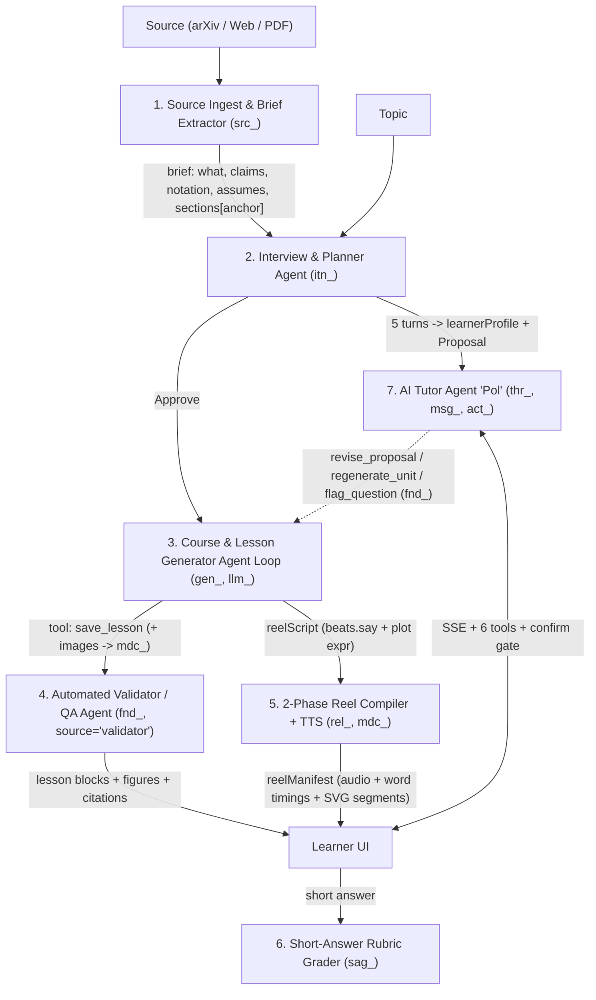

# Báo cáo kỹ thuật: Reverse Engineering toàn diện `web.polyskill.app` bằng Craft Anything

> **Ngày cập nhật:** 2026-11-22 (nâng cấp toàn diện từ bản khảo sát sơ bộ 2026-10-30 bằng REA 6.7.0).
> **Phạm vi:** Phân tích tĩnh toàn bộ Metro bundle frontend (2.177 modules) + chụp live page công khai (`https://web.polyskill.app/home` → redirect `/sign-in`) ở 3 viewport (`1440×900`, `768×900`, `390×900`). **Clean-room behavioral & contract documentation** — không sao chép mã nguồn/tài sản, không lưu cookie/token/PII, không can thiệp backend hay vượt cơ chế xác thực.
> **Công cụ:** Craft Anything MCP `0.6.1` (`web_site_open`, `web_site_capture`, `web_page_show`, `web_page_js_analyze`, `web_scripts_save`, `js_sources_restore`, `core_evidence_browse`) + Chrome/Brave `157.0.8103.50` (CDP 1.3).
> **Bằng chứng chính (Evidence Ledger):**
> - Live open (`/home` → `/sign-in`): `ev_c798aac7d87351c3e8eba04450e7a7b26626382bc7c622ea726c96fde0980436`
> - Live capture (HTML + CSS custom properties + 3 screenshots): `ev_c9d5d94801f96fd4769ca9e20ac9b3ce84c494480b22c5dc0d378bb02191a1f6`
> - Passive page inspection + script texts: `ev_60ba46728102e5f8c74fe0a89342a63896fb6fb48690e5b2fdd4157b0390e5a8`
> - Static JS analysis (10.758 graph nodes, 15.075 edges): `ev_a7cb7667c577580aa537c5c6ecb8b88db685093e36bb06665318e1d95b631fb7`
> - Saved scripts (26 scripts, 5.849.644 bytes): `ev_3025c63307879806bd846f2991415fefa126729f4014e6341a664c8b9cd6fa8c`
> - Structural source restoration: `ev_01f458bd239ce4d78dee5f77912fa70b47dfad47732ed1d19ed28fbafce61b14`
> - **Bundle chính:** `https://web.polyskill.app/_expo/static/js/web/entry-a3803cab42a2ab75ae9ef2e391ee92d0.js` — **5.849.374 bytes**, SHA-256 `e7f84aaffae7a3be5d943437e1ccd084a69c12aad1675f3bcc841703bde5d4ce`.
>
> **Đối chiếu delta 2026-10-30 → 2026-11-22 (FACT):** PolySkill hiện vẫn phục vụ **chính xác cùng 1 bundle** (trùng URL, byte size và SHA-256). Đợt reverse này đi sâu xuống **toàn bộ 2.177 Metro modules**, giải mã đầy đủ 19 shared Zod contract modules, 15 màn hình Expo Router, 48+ API endpoints, **Reel audiovisual engine**, 5 practice formats, cơ chế chấm điểm/offline SQLite/outbox, gamification, billing Polar+SePay và hệ thống thông báo — những phần chưa được khai thác trong báo cáo ngày 2026-10-30.

---

## 1. Stack, cấu hình & kiến trúc tổng thể (`OBSERVED_STATIC`)

| Thành phần | Bằng chứng trực tiếp trong bundle |
|---|---|
| **Expo SDK 57 + React Native Web** | Manifest nhúng: `name: "PolySkill"`, `slug: "polyskill-app"`, `version: "1.0.0"`, `sdkVersion: "57.0.0"`, `owner: "qnguyen3"`, `bundler: "metro"`, `experiments.typedRoutes: true` |
| **React 19.2.3 + Metro** | 1 bundle web duy nhất (`5.849.374 bytes`, `2.177` module `__d(...)`), không code-splitting |
| **Routing** | `expo-router` với `Stack.Protected` guard theo `authStatus` (`signedIn` / `signedOut`) |
| **State & Server Cache** | **Zustand** (`M989`/`M990`: `useAuthStore`, `useTutorStore`, `useLessonStore`, `useLanguageStore`, `usePaywallStore`, `useSettingsStore`, `useAvatarPickerStore`, `useSyncStore`) + **TanStack Query** (`M1813`: `staleTime: 30s`, `gcTime: 24h`, `networkMode: 'always'`, retry 3× backoff `1s→8s` chỉ cho lỗi mạng) |
| **Schema Validation** | **Zod v4** (`M819`/`M820` + **19 module shared contracts** xuất từ `M817`) validate toàn bộ response từ server |
| **Animation & Gesture** | `react-native-reanimated` + `react-native-worklets` + `react-native-gesture-handler` (`Gesture.Pan` cho SpeedRound) + `react-native-keyboard-controller` |
| **Math & Audio** | **MathJax** (`M2096` `splitMath` tách inline `$...$`) + **`expo-audio`** (`AudioPlayerWeb` cho narrated Reels) |
| **Offline Persistence** | **`expo-sqlite`** (`polyskill.db`, `PRAGMA journal_mode = WAL`, `user_version = 3`, 6 bảng + attempt outbox) |
| **Telemetry** | **Mixpanel** (`https://api.mixpanel.com/track?verbose=1`, `M976`, chỉ 4 client events; trên web hiện bị lỗi CORS preflight `content-type` — quan sát trực tiếp tại `ev_c798…`) |
| **App Config (`M975`)** | `apiBaseUrl: "https://api.polyskill.app"`, `apiPrefix: "/v1"`, `appVersion: "1.0.0"`, `leagues: false`, `adaptyKey: ""` |

### Feature Switches (`M913`, `M1789`)
- `FEATURE_SWITCHES = { leagues: 'leagues' }` — hiện **TẮT trên web** (`appConfig.leagues === false`), dù toàn bộ UI + API client + Push handler cho Leagues đã build sẵn trong bundle.

### Client Storage Keys (`ev_eea7…`, `M1370`, `M1780`, `M1793`, `M1867`)
- `localStorage`: `polyskill.installId`, `polyskill.refreshToken`, `polyskill.theme` (`'light' | 'dark'`, vắng = `'system'`), `polyskill.appLanguage`, `EXPO_NOTIFICATIONS_INSTALLATION_ID`, `EXPO_NOTIFICATIONS_REGISTRATION_INFO`, `ExpoWebBrowserRedirectHandle`.
- `sessionStorage`: `polyskill.signin.request`, `polyskill.signin.result`, `polyskill.checkout`.
- Native SecureStore (iOS/Android): `polyskill.expoPushToken` (`WHEN_UNLOCKED_THIS_DEVICE_ONLY`).

---

## 2. Bản đồ đầy đủ 15 Expo Router Screens & 5 Global Sheets (`M9`, `M1808`)

### Routes (`Module 9`)

| # | Route file | Module | Auth guard | Chức năng chính |
|---|---|---|---|---|
| 1 | `./_layout.tsx` | `M1808` | Root | Font load, auth bootstrap + `resumeWebSignIn`, `installSync`, `installLanguage`, `OfflineBar`, Push deep-link router, mount 5 global sheets |
| 2 | `./index.tsx` | `M1869` | `signedIn` | Redirect vào `/onboarding` (nếu `onboardedAt == null`) hoặc `/(tabs)/home` |
| 3 | `./sign-in.tsx` | `M2181` | `signedOut` | OAuth Apple + Google (không có email/password), link `polyskill.app/terms` & `/privacy` |
| 4 | `./onboarding.tsx` | `M2170` | `signedIn` | Luồng `HelloStep → LanguageStep → QuestionStep (4 bước: roles, topics, learningStyles, goals) → ReminderStep → DoneStep` |
| 5 | `./(tabs)/_layout.tsx` | `M10` | `signedIn` | Desktop (`≥1024px`): `SideNav` cố định `264px` (`M1024`); Mobile: Bottom Tab Bar (`Home`, `Learn`, `New`, `Pol`, `You`) |
| 6 | `./(tabs)/home.tsx` | `M1757` | `signedIn` | Greeting theo ngày, Resume Hero (`upNext`), Active courses, Completed courses, `WeekRecapCard`, Streak nudge/frozen note |
| 7 | `./(tabs)/new.tsx` | `M1798` | `signedIn` | Nhập chủ đề (1..200 ký tự) hoặc gắn nguồn qua `AddSourceMenu` (`pdf`, `arxiv`, `url` — chặn link YouTube qua `isVideoLink`), hiện paywall/quota nếu hết `course_limit` |
| 8 | `./(tabs)/course/[id].tsx` | `M1651` | `signedIn` | Course path theo Units (`ember`/`bone`), `CourseSourceRow`, lesson node states (`done`/`current`/`preparing`/`locked`/`failed`), `Pro` unit paywall, thẻ "Too easy? Too hard?" gọi Pol (`path_harder`) |
| 9 | `./(tabs)/profile.tsx` | `M1807` | `signedIn` | Display name, avatar, 4 stat tiles (streak/XP/lessons/accuracy), `WeekChart`, `Milestones` (7 categories), `LeagueCard` (nếu flag bật), `SettingsButton` |
| 10 | `./league/index.tsx` | `M1870` | `signedIn` | Bảng xếp hạng 30 người/cohort, 5 tier (`Bronze → Ruby`), vùng `promote / hold / demote`, kết quả tuần trước (`GET /v1/league/last`) |
| 11 | `./lesson/[id]/index.tsx` | `M2121` | `signedIn` | Player bài học: `ReelPlayer` intro (nếu có) → `TeachBlockView` → `RecapView` → Quiz (`McQuestion`, `StepsQuestion`, `SpeedRound`, `BlankQuestion`, `OrderQuestion`, `MatchQuestion`, `ShortQuestion`) + `VocabSheet` + `Hỏi Pol` |
| 12 | `./lesson/[id]/complete.tsx` | `M1871` | `signedIn` | Tổng kết bài học: `predictRewards` lạc quan khi offline hoặc settle kết quả từ outbox (`xp`, `streakDays`, `freezeBanked`, `milestonesEarned`, `levelsEarned`, `UnitBreakdown` theo `sources[]`, `Confetti`) |
| 13 | `./new/source.tsx` | `M2169` | `signedIn` | Theo dõi pipeline ingest nguồn (`poll 1.5s`), hiển thị `SourceCard` + `brief` (`what`, `claims`, `sections`) + nút tạo khóa từ nguồn |
| 14 | `./new/interview.tsx` | `M2162` | `signedIn` | Phỏng vấn 5 câu (`position 0..4`, `single`/`multi`, 2..6 choices) → poll `GET /courses/{id}/plan` (`2s`) → `PlanChat` + `ProposalCard` (có chat trực tiếp với Pol để gọi `revise_proposal`) → `Approve` |
| 15 | `./new/generating.tsx` | `M2161` | `signedIn` | Poll `GET /courses/{id}/generation` mỗi `2s`, hiển thị 4 bước cố định (`GENERATION_STEPS`), nút Retry nếu lỗi `retryable: true` |

> **Dev routes khai báo trong `_layout.tsx` (`M1808`):** `(dev)/gallery`, `(dev)/reel` (không có trong route map production `M9`).
> **5 Global Sheets mount tại `_layout.tsx`:** `TutorSheet` (`M1852`), `SettingsSheet` (`M1783`), `AvatarSheet` (`M1795`), `PaywallSheet` (`M1848`), `LinkAccountSheet` (`M1846`).

---

## 3. Giao thức HTTP, Header đàm phán, ID Prefixes & 26 Error Codes (`M967`, `M818`, `M898`, `M901`)

### HTTP Client (`M967` `apiRequest`)
- **Base URL:** `https://api.polyskill.app/v1`
- **Headers mặc định gửi mọi request:**
  - `accept: application/json`
  - `x-client-platform: "web"` (`ios | android | web`)
  - **`x-client-blocks: "short"`** (`CLIENT_BLOCKS_HEADER` / `OPTIONAL_BLOCK_TYPES = ['short']` — cơ chế capability negotiation để server chỉ trả block `short` cho client hỗ trợ!)
  - `authorization: Bearer <accessToken>` (trừ khi `anonymous: true`)
  - `idempotency-key: idem_<uuid>` (tự động gắn cho mọi `POST`, `PUT`, `PATCH`, `DELETE`)
- **Timeout mặc định:** `20s` (`createCourse` & `answerInterview`: `60s`; `gradeShortAnswer`: `18s`; PDF PUT lên `uploadUrl`: `120s`).
- **Auto-refresh 401:** Khi nhận 401 với `code === 'TOKEN_EXPIRED'`, client single-flight gọi `POST /v1/auth/refresh`, lưu `refreshToken` mới và replay request; các mã fatal (`TOKEN_INVALID`, `REFRESH_INVALID`, `UNAUTHENTICATED`, `ACCOUNT_DELETED`) buộc `onAuthFailure()` → sign out.
- **Error Envelope chuẩn (`M818`):** `{ error: { code, message, details?, requestId? } }`.

### 26 `ERROR_CODES` chuẩn hóa (`M818`)
`INTERNAL`, `NOT_FOUND`, `BAD_REQUEST`, `VALIDATION_FAILED`, `RATE_LIMITED`, `CONFLICT`, `SERVICE_UNAVAILABLE`, `TOPIC_REJECTED`, `COURSE_WRONG_STATE`, `GENERATION_EXHAUSTED`, `LESSON_LOCKED`, `LESSON_NOT_READY`, `OUT_OF_HEARTS`, `TUTOR_LIMIT_REACHED`, `ENTITLEMENT_REQUIRED`, `UNAUTHENTICATED`, `TOKEN_EXPIRED`, `TOKEN_INVALID`, `REFRESH_INVALID`, `IDENTITY_TOKEN_INVALID`, `PROVIDER_UNSUPPORTED`, `ACCOUNT_DELETED`, `ACCOUNT_LINK_REQUIRED`, `LINK_TICKET_INVALID`, `IDENTITY_ALREADY_LINKED`, `PROVIDER_ALREADY_LINKED`.

### 23 ULID `ID_PREFIXES` (`M898`, format `^<prefix>_[0-9A-HJKMNP-TV-Z]{26}$`)
Tiết lộ gần như đầy đủ thực thể dữ liệu phía backend:
`usr_` (user), `ses_` (session), `aid_` (authIdentity), `crs_` (course), `itn_` (interviewTurn), **`llm_` (llmCall)**, `unt_` (unit), `lsn_` (lesson), `atm_` (attempt), `xpe_` (xpEvent), `trm_` (term), `gen_` (generationRun), **`fnd_` (contentFlag)**, `psh_` (pushToken), `lgc_` (leagueCohort), `lgm_` (leagueMembership), `thr_` (thread), `msg_` (message), `act_` (tutorAction), **`sag_` (shortAnswerGrade)**, **`rel_` (reel)**, **`mdc_` (mediaCall)**, `src_` (source).

---

## 4. Danh mục đầy đủ 48+ API Endpoints (`OBSERVED_STATIC` từ call-sites)

### 4.1 Auth, User, Onboarding, Identities & Notifications (`M1670`, `M1779`, `M1785`, `M1737`)

| Method | Path | Request / Query | Response Schema / Ghi chú |
|---|---|---|---|
| `POST` | `/v1/auth/exchange` | `{provider: 'apple'\|'google', identityToken, nonce?, timezone, locale?, fullName?, deviceLabel?}` | `authSessionResponseSchema` (`accessToken`, `refreshToken`, `expiresIn`, `user`); lỗi `ACCOUNT_LINK_REQUIRED` trả `accountLinkChallengeSchema` |
| `POST` | `/v1/auth/link/confirm` | `{linkTicket, timezone, deviceLabel?}` | `authSessionResponseSchema` |
| `POST` | `/v1/auth/refresh` | `{refreshToken}` | `authRefreshResponseSchema` (rotate refresh token) |
| `POST` | `/v1/auth/signout[?all=true]` | `{refreshToken?, pushToken?}` | `{signedOut: true, revoked: int}` |
| `GET` | `/v1/me` | — | `{user}` (`displayName`, `avatar`, `timezone`, `locale`, `appLanguage`, `lessonLanguage`, `goalLessons: 1\|2\|3`, `onboardedAt`) |
| `PATCH` | `/v1/me` | `{displayName?, timezone?, locale?, appLanguage?, lessonLanguage?, goalLessons?, avatar?}` | `{user}` (avatars: `happy`, `graduate`, `curious`, `wink`, `excited`) |
| `DELETE` | `/v1/me` | — | `{deleted: true, purgeScheduledAt}` |
| `PUT` | `/v1/me/onboarding` | `{roles[], topics[], learningStyles[], goals[]}` | `{user}` (4 danh mục enum cố định ở `M904`) |
| `GET` | `/v1/me/identities` | — | `{identities: [{provider, email, linkedAt}]}` |
| `POST` | `/v1/me/identities` | `{provider, identityToken, nonce?}` | `{identities[]}` |
| `GET` | `/v1/me/notifications` | — | `{notifications: {courseReady, leagueResults, dailyReminder, streakGuard, reminderSlot, reminderTime}}` |
| `PATCH` | `/v1/me/notifications` | Partial `notificationPrefsSchema` | `{notifications}` (`reminderTime` theo bước 15 phút `HH:MM`) |
| `POST` | `/v1/push/register` | `{token: ExpoPushToken, platform: 'ios'\|'android'}` | `{registered: true}` |
| `DELETE` | `/v1/push/register` | `{token}` | `{unregistered: true}` |

### 4.2 Home, Stats, Profile & Leagues (`M767`, `M1661`)

| Method | Path | Response Schema / Ghi chú |
|---|---|---|
| `GET` | `/v1/home` | `{greeting{dayName,title}, avatarInitial, stats, upNext, courses[], completedCourses[], lastWeek}` |
| `GET` | `/v1/me/stats` | `{today, streak{current,best,lastActiveDay,freezes,frozenDays}, hearts{count,max,nextRefillAt}, goal{earnedToday,target,met}, totalXp}` (`staleTime: 15s`, auto-invalidate đúng lúc sang ngày mới) |
| `GET` | `/v1/me/profile` | `{displayName, avatarInitial, avatar, joinedAt, courseCount, stats{streak,totalXp,lessonsCompleted,accuracy}, week{totalXp,days[7]}, milestones[], milestoneLadder[], milestoneCategories[], league, lastWeek}` |
| `GET` | `/v1/league` | `{cohort: {tier, name, weekKey, daysLeft, memberCount, rank, standings[], promoteCount, demoteCount} \| null}` |
| `GET` | `/v1/league/last` | `{result: {weekKey, tier, name, rank, xp, memberCount, outcome, nextTier, nextName} \| null}` |

### 4.3 Courses, Interview, Proposal, Plan & Generation (`M1758`, `M1737`, `M2168`)

| Method | Path | Request / Timeout | Response Schema / Ghi chú |
|---|---|---|---|
| `POST` | `/v1/courses` | `{topic: 1..200, sourceId?}` (timeout `60s`, idempotent) | `{course, turn}` (`turn.position = 0`); lỗi `TOPIC_REJECTED` kèm `{reason: 'unsafe'\|'too_vague'\|'not_teachable'\|'too_narrow', suggestedRephrase?}` |
| `GET` | `/v1/courses/{id}` | — | `{course, turns[]}` |
| `POST` | `/v1/courses/{id}/interview/answer` | `{position: 0..4, answers: string[1..6]}` (timeout `60s`, idempotent) | `{done: bool, turn: interviewTurn \| null}` (`kind: 'single'\|'multi'`, `choices[2..6]`) |
| `GET` | `/v1/courses/{id}/plan` | Poll mỗi `2s` khi `status === 'pending'` | `{status: 'pending'\|'ready'\|'failed', proposal, learnerProfile{priorKnowledge,gaps,strengths,sessionMinutes: 5\|15\|30}, message}` |
| `POST` | `/v1/courses/{id}/approve` | idempotent | `{course}` (chuyển sang `generating`) |
| `GET` | `/v1/courses/{id}/generation` | Poll mỗi `2s` đến khi `ready\|failed` | `{courseId, courseName, status: 'queued'\|'running'\|'ready'\|'failed', step: 0..3, stepDetail, steps[4], readyAt, error{code,message,retryable}?}` |
| `POST` | `/v1/courses/{id}/retry` | idempotent | `{courseId, status, attempt}` |
| `DELETE` | `/v1/courses/{id}` | idempotent | `{deleted: true, courseId}` (+ xóa cache SQLite) |

> **Lưu ý về sửa Proposal (`M905`, `M2163`, `M2166`):** Schema `updateProposalRequestSchema` tồn tại trong `@polyskill/shared`, nhưng trên UI web PolySkill thực hiện sửa proposal **qua hội thoại với Pol (`entryPoint: 'proposal'`)**, khi Pol gọi tool `revise_proposal` thành công thì `PlanChat` tự trượt `ProposalCard` xuống tin nhắn mới nhất và thu gọn bản cũ thành nhãn `"Earlier draft"`.

### 4.4 Path, Glossary, Lessons, Grading & Attempts (`M1652`)

| Method | Path | Request / Timeout | Response Schema / Ghi chú |
|---|---|---|---|
| `GET` | `/v1/courses/{id}/path` | Poll mỗi `5s` nếu có node `preparing` | `{courseId, courseName, status, progress{completed,total,percent}, units[{id,position,title,kicker,blurb,tone:'ember'\|'bone',paywalled?,nodes[]}], upNextLessonId, source}` |
| `GET` | `/v1/courses/{id}/glossary` | `staleTime: Infinity` (cached SQLite) | `{terms: [{key, name, kind, teaser, short, more, firstSeen:{unit,lesson}\|null}]}` |
| `GET` | `/v1/lessons/{id}[?prefetch=1]` | `?prefetch=1` khi background prefetch | `{lesson{id,courseId,unitId,position,title,kind,format?,estimatedMinutes,blocks[],reel?,contentVersion,completedAt,attemptCount,lastScore}, terms[], source}` |
| `POST` | `/v1/lessons/{id}/retry` | idempotent | `{lessonId, status}` |
| `POST` | `/v1/lessons/{id}/blocks/{index}/grade` | `{answer: 10..400 chars, contentVersion}` (timeout `18s`) | `{gradeId, verdict: 'got_it'\|'almost'\|'not_yet', keyPoints: boolean[], feedback}` |
| `POST` | `/v1/lessons/{id}/grades/{gradeId}/dispute` | — | Báo cáo tranh chấp kết quả chấm `short` khi `verdict === 'not_yet'` |
| `POST` | `/v1/lessons/{id}/attempts` | `{clientAttemptId, startedAt, durationMs, contentVersion?, results[], heartsLost?}` (idempotent = `clientAttemptId`) | `{attemptId, lessonId, duplicate, completedAt, score, rewards{xp,totalXp,streakDays,streakExtended,freezeBanked,milestonesEarned[],levelsEarned[],hearts,goal,flagged}}` |

### 4.5 Sources & Document Ingestion (`M1799`, `M1800`, `M900`)

| Method | Path | Request | Response / Pipeline |
|---|---|---|---|
| `POST` | `/v1/sources` | `{url: 1..2000}` (arXiv ID/URL hoặc web URL; client chặn YouTube) | `{source}` |
| `POST` | `/v1/sources/upload` | `{filename: 1..200, byteSize: 1..26214400 (25 MB)}` | `{source, uploadUrl, expiresIn}` → client `PUT uploadUrl` với `content-type: application/pdf` (timeout `120s`) |
| `POST` | `/v1/sources/{id}/ingest` | idempotent (`<key>-ingest`) | `{source}` — khởi chạy pipeline `awaiting_upload → pending → extracting → ready \| failed` |
| `GET` | `/v1/sources/{id}` | Poll mỗi `1.5s` đến khi `ready\|failed` | `{source}` kèm `brief: {what, claims[1..10], notation[≤20], assumes[≤10], sections[≤40]{anchor,heading,gist}}`, `wordCount`, `durationMinutes`, `suggestedTopic`, `rejectReason` |
| `DELETE` | `/v1/sources/{id}` | idempotent | `{deleted: true, sourceId}` |

### 4.6 AI Tutor ("Pol") — REST + SSE (`M1853`, `M1858`, `M912`, `M1021`, `M1022`)

| Method | Path | Query / Request | Response / Hành vi |
|---|---|---|---|
| `GET` | `/v1/courses/{id}/tutor` | `?entryPoint=&lessonId=&blockIndex=&termKey=&unitId=&threadId=&before=` | `{threadId, kind: 'course'\|'anchor'\|'task', title, sealed, messages[], nextCursor, limit{remaining,limit,resetAt}, allowance?{remaining,limit}}` (poll `5s` nếu có `action.status === 'preparing'`) |
| `GET` | `/v1/tutor/sessions` | — | `{sessions: [{threadId, courseId, courseTitle, title, lastMessageAt}]}` (nhóm theo `This week` / `Earlier`) |
| `POST` | `/v1/courses/{id}/tutor/sessions` | — | `{threadId}` |
| `POST` | `/v1/courses/{id}/tutor/messages` | Headers `accept: text/event-stream`, `last-event-id?`; body `{text: 1..2000, entryPoint, contextRef?, threadId?, clientMessageId}` | SSE stream với 6 event types: `delta {text}`, `tool {name,summary,ok}`, `confirm (tutorAction)`, `done {threadId?,message,limit,allowance?}`, `error {code,message}`, `restarted` |
| `POST` | `/v1/courses/{id}/tutor/messages/{msgId}/stop` | `?entryPoint=&...` | Dừng lượt stream đang chạy |
| `POST` | `/v1/courses/{id}/tutor/actions/{actionId}/{result}` | `result`: `confirm` / `decline` | `{action}` — xử lý `ChangeCard` cho `regenerate_unit` (`pending → confirmed\|declined → preparing → ready\|failed\|unavailable`) |

### 4.7 Entitlements & Billing — Polar.sh + SePay VietQR (`M1755`, `M1756`, `M1793`, `M1848`, `M1849`, `M1850`, `M914`, `M915`)

| Method | Path | Request | Response / Ghi chú |
|---|---|---|---|
| `GET` | `/v1/me/entitlement` | — | `{tier: 'free'\|'pro', expiresAt, subscription{store:'app_store'\|'play_store'\|'polar', renews}, limits{courses{used,limit,resetAt}, tutorAllowance, openUnits}}` |
| `POST` | `/v1/billing/sync` | — | `entitlementResponseSchema` (tự động gọi khi quay lại từ checkout `sessionStorage['polyskill.checkout']`) |
| `GET` | `/v1/billing/plans` | — | `{plans: [{id, months, amount, currency}]}` (Polar.sh cho web) |
| `POST` | `/v1/billing/checkout` | `{planId, returnUrl}` | `{url}` (redirect sang Polar checkout) |
| `POST` | `/v1/billing/portal` | `{returnUrl}` | `{url}` (customer portal quản lý gói) |
| `GET` | `/v1/billing/sepay/plans` | — | `{plans[]}` (mặc định chọn VietQR nếu timezone là `Asia/Ho_Chi_Minh` hoặc `Asia/Saigon`!) |
| `POST` | `/v1/billing/sepay/orders` | `{planId}` | `sepayOrderSchema` (`{code, paid, months, amount, currency, qrUrl, bank, accountNumber, accountName}`) |
| `GET` | `/v1/billing/sepay/orders/{code}` | Poll mỗi `3s` đến khi `paid: true` | `sepayOrderSchema` (thanh toán một lần, không tự gia hạn) |

---

## 5. Các phân hệ chuyên sâu mới được phát hiện qua Craft Anything (`OBSERVED_STATIC`)

### 5.1 Lesson Content, 6 Block Types, 4 Figure Kinds & 5 Practice Formats (`M899`, `M906`, `M2107`–`M2120`)
- **6 block types** (`1..24` blocks/bài): `teach`, `mc`, `blank`, `order`, `match`, `short`.
  - **`teach`**: `kicker`, `title`, `figure` **HOẶC** `image` (không bao giờ cả hai; `image.describe`: *"Filled in by the server from save_lesson's images. Never write one."* → hé lộ server có tool **`save_lesson`**), `placement` (`top|middle|end`), `paragraphs[1..2]` (mỗi đoạn tối đa 5 câu, hỗ trợ inline `{termKey, text}` và MathJax `$...$`), `terms[≤6]`, `takeaway?`, `cite? {anchor, label}`.
  - **`mc`**: `options[3..4]`, `answer` (index 0-based), `outcomes[3..4]?` (cho format `scenario`), `display: 'steps'?` (cho format `spot`).
  - **`blank`**: `parts` (chuỗi + `{blank: 0..n}` liên tục từ 0), `answers[1..4]` (không trùng nhau), `bank[2..10]` (bắt buộc có ít nhất 1 distractor).
  - **`order`**: `items[3..5]` (thứ tự đúng, client tự shuffle bằng `seed`), `scale? {top, bottom}`.
  - **`match`**: `pairs[3..4]` tuple `[left, right]`.
  - **`short`**: `keyPoints[2..3]`, `modelAnswer` (`10..400` chars).
- **4 loại Figure (`M899`):**
  1. `formula`: `parts[1..9]` (`{text, termKey?}`)
  2. `table`: `head[2..3]`, `rows[2..5]` (`cells`, `tone: 'moss'|'clay'|'neutral'`) — **chưa có trong báo cáo cũ!**
  3. `visual` & 4. `diagram`: **7 layout chuẩn hóa** với luật `superRefine` nghiêm ngặt: `flow` (2–5 nodes, mũi tên + `above`/`below`), `timeline` (3–5, `above`), `branch` (3–4, mũi tên), `cycle` (3–4, label ≤14 chars), `stack` (2–5, `both`), `split` (4–8 chẵn, 2 `groupLabels`), `hub` (4–6).
- **5 Practice Formats (`M906`, `M1004`):** `scenario` ("What would you do?" dùng `mc.outcomes`), `spot` ("Spot the mistake" dùng `mc.display='steps'` + `StepsQuestion`), `speed` (**`SpeedRound`** — 60s swipe deck đúng/sai dùng `Gesture.Pan`, ngưỡng commit 28% width hoặc velocity 700), `explain` ("Explain it to Pol" dùng `short`), `recap` (tóm tắt dạng Reel).
- **Cơ chế chấm điểm phía client vs server (`M2107`, `M2118`):**
  - `mc`, `blank`, `order`, `match` được **chấm trực tiếp trên client** (đáp án nằm trong payload `lesson.blocks`). Kết quả ghi vào `attempt.results` **khóa ngay ở lần thử đầu tiên (`attempts === 0`)**; sau khi sai người học vẫn được retry có gợi ý (loại option đã sai, giữ ô blank đúng, giữ prefix order đúng). Với `match`, `correct = (pairMisses === 0)`.
  - Chỉ `short` gọi server `POST /lessons/{id}/blocks/{index}/grade` (`verdict: 'got_it' | 'almost' | 'not_yet'`, pass khi `!== 'not_yet'`). Nếu offline hoặc lỗi mạng/timeout `18s`, client tự fallback sang **`SelfMarkFooter`** (tự chấm theo `keyPoints` & `modelAnswer`). Khi bị chấm `not_yet`, có nút **Dispute** gọi `POST /lessons/{id}/grades/{gradeId}/dispute`.
  - Các câu hỏi có field `sources?: number[]` (1..60) để màn hình `complete.tsx` tính **`UnitBreakdown`** (`scoreBySource`) theo từng bài gốc!

### 5.2 Narrated Audiovisual "Reel" Engine (`M908`, `M2122`–`M2160`) — **MỚI PHÁT HIỆN**
- Mỗi bài học có thể đính kèm `lesson.reel: reelManifestSchema` (`version: 1`, `styleVersion`, `language`, `durationMs`, `scenes[]`).
- **11 Scene Kinds:** `title`, `statement`, `bullets`, `term`, `compare`, `figure`, `chart` (`bar` / `line` / `donut`), `code`, `equation` (các bước LaTeX), `plot` (đồ thị hàm số SVG với `curves`, `points`, `tangents`, `areas`!), `ready` (+ `fallback`).
- **Đồng bộ âm thanh – hoạt hình (`M2142`, `M2143`, `M2159`, `M2160`):**
  - Mỗi scene có `audio {url, durationMs}`, mảng `words [{text, startMs, endMs}]` cho phụ đề chạy chữ (`Captions`), và `beats [{startMs, cues: [{verb: 'rise'|'draw'|'count'|'pulse', target}]}]`.
  - Tốc độ phát `SPEEDS = [1, 1.25, 1.5]`, ngưỡng resync `DRIFT_TOLERANCE_MS = 80ms`.
  - Âm thanh reel được cache offline trong bảng `cached_reel_clips` (`polyskill.db`).

### 5.3 Citations & Giải mã lý do PDF Citation là pill tĩnh (`M1753`, `M2097`)
- `citationUrl(source, anchor)`:
  - Parse anchor `§1.2` → `S1` (mục LaTeXML trên arXiv HTML) hoặc `#slug` → `slug`.
  - `kind === 'arxiv'` → `canonicalUrl.replace('/abs/', '/html/') + '#' + id`.
  - `kind === 'web'` → `canonicalUrl + '#' + id`.
  - `kind === 'pdf'` → `canonicalUrl` là `null` → trả `null` → `CitationLink` chủ ý render thành pill tĩnh (`bone`/`ink3`) không click được! (Giải đáp hoàn toàn ghi nhận `navigable: false` ở báo cáo audit 2026-11-04.)

### 5.4 Gamification, Hằng số thưởng & Leagues (`M902`, `M911`, `M1666`, `M1770`, `M1771`)
- **Hằng số chuẩn:** `HEARTS_MAX = 5`, `XP_LESSON_BASE = 80`, `XP_PERFECT_BONUS = 20` (hoàn hảo = 100 XP), `GOAL_LESSON_LEVELS = [1, 2, 3]`, `DAILY_GOAL_XP = 80`, `STREAK_FREEZE_EARNED_EVERY = 7` ngày, `STREAK_FREEZE_MAX = 2`.
- **Dự đoán thưởng offline (`M1666` `predictRewards`):** Khi offline, màn hình hoàn thành bài học tự tính `xp`, `streakExtended` (`earnedToday < target && earnedToday + xp >= target`), `freezeBanked` (`streakExtended && freezes < 2 && streakDays % 7 === 0`).
- **Milestones:** 7 danh mục nhiều cấp (`streak`, `practice_days`, `lessons`, `perfect_lessons`, `clean_run`, `units`, `courses`) + 9 ladder milestones (`first_stone`, `three_in_row`, `cairn_raised`, `one_week`, `ten_stones`, `clean_run`, `two_weeks`, `one_month`, `first_course`); mốc streak đặc biệt: `[3, 7, 14, 30]` ngày.
- **Leagues (`M911`, hiện tắt flag trên web):** 5 hạng (`bronze`, `silver`, `gold`, `sapphire`, `ruby`), `LEAGUE_COHORT_SIZE = 30`, vùng `promote / hold / demote`, kết quả `promoted / held / demoted`.

### 5.5 Offline-First SQLite & Attempt Outbox (`M918`, `M1653`, `M1660`, `M1662`, `M1663`, `M1738`)
- Database `polyskill.db` (`PRAGMA journal_mode = WAL`, `user_version = 3`) gồm **6 bảng**:
  1. `cached_courses (id, payload, fetched_at)`
  2. `cached_lessons (id, course_id, payload, content_version, fetched_at)` — tự xóa lesson cache khi `content_version <> ?` lúc refresh path!
  3. `cached_glossary (course_id, payload, fetched_at)`
  4. `outbox_attempts (client_attempt_id, lesson_id, course_id, payload, created_at, attempts, last_error, next_retry_at)`
  5. `cached_reel_clips (url, lesson_id, fetched_at)`
  6. `local_prefs (key, value)` (gồm `outbox.owner` chống trộn outbox giữa các tài khoản)
- **Outbox Flush (`M1660`):** FIFO theo `created_at ASC`; lỗi 4xx trừ `{401, 408, 409, 429}` bị drop vĩnh viễn (`recordRefusal`); lỗi mạng/5xx/429 retry theo exponential backoff `min(5s × 2^(attempts-1), 300s)`.
- **Background Prefetch (`M1663`, `M1738`):** Khi online, tự prefetch path + glossary + tối đa **3 bài sẵn sàng tiếp theo** trên Wi-Fi (**1 bài** trên mạng di động), bỏ qua unit `paywalled`, cho tối đa 3 khóa gần nhất.

### 5.6 AI Tutor ("Pol") — Chi tiết kiến trúc (`M912`, `M1021`, `M1022`, `M1853`, `M1860`, `M1863`, `M1009`)
- **3 loại thread (`kind`):** `course` (toàn khóa), `anchor` (`lesson:{id}:block:{idx}` hoặc `term:{key}`), `task` (`unit:{id}` cho `path_harder` hoặc `proposal` cho `PlanChat`).
- **6 Entry points & prompt chips tương ứng (`M1009`, `M1859`):** `tab`, `wrong_answer`, `teach_block`, `term`, `path_harder`, `proposal`.
- **6 Tools khai báo ở client:** `regenerate_unit`, `flag_question`, `explain_deeper`, `read_lesson`, `revise_proposal`, `read_source`.
- **Action Confirm (`regenerate_unit`):** Hiện `ChangeCard` (`M1860`) với `preview: {unitTitle, direction: 'harder'|'easier'|'more_practical', lessonTitles[], notes}` và 2 nút xác nhận/từ chối; sau khi confirm, poll thread mỗi `5s` trong lúc `status === 'preparing'`.
- **Content Flagging taxonomy (`M912`):** `contentFlagSource: 'validator' | 'tutor'`; `contentFlagCode: 'figure_mismatch' | 'unanswerable' | 'ambiguous' | 'weak_distractors' | 'wrong_answer' | 'other'`.
- **Free vs Pro Allowance (`M1003`):** Free = 1 khóa học, chỉ mở Unit 1, 25 câu hỏi cho Pol; Pro = 25 khóa mới/tháng, mọi unit, không giới hạn câu hỏi Pol.

### 5.7 Notifications, Retention & i18n (`M903`, `M906`, `M910`, `M991`–`M1020`, `M1866`–`M1868`)
- **7 loại Push (`M906`):** `course.ready`, `course.failed`, `league.settled`, `daily.reminder`, `streak.guard`, `weekly.recap`, `comeback.nudge` (bước nhắc quay lại: ngày thứ `2, 4, 8, 15`).
- **Lịch nhắc (`M910`):** 3 khung mặc định (`morning: 08:00`, `midday: 12:45`, `evening: 18:30`), chỉnh theo bước `15` phút; quiet hours `22:00–08:00`; `STREAK_GUARD_TIME = 21:00` (tối thiểu streak 3 ngày).
- **12 ngôn ngữ (`M903`):** `en`, `es`, `pt-BR`, `fr`, `de`, `it`, `sv`, `vi`, `ja`, `ko`, `zh-Hans`, `id`. Tách riêng **`appLanguage`** (ngôn ngữ UI) và **`lessonLanguage`** (ngôn ngữ nội dung bài học).

---

## 6. Kiến trúc Multi-Agent & Dấu vết Thuật toán suy luận từ `@polyskill/shared` (`DERIVED` vs `UNKNOWN`)

> **Giới hạn nguyên tắc:** Toàn bộ code Agent, prompt, LLM/TTS API, thuật toán truy xuất và cá nhân hóa đều chạy trên backend `api.polyskill.app` nên **không thể reverse trực tiếp mã nguồn thuật toán**. Tuy nhiên, vì PolySkill chia sẻ cùng gói `@polyskill/shared` (Zod v4 `M817`–`M915`) giữa backend LLM tools và frontend, 7 thành phần kiến trúc Agent/Pipeline đã lộ diện rõ ở mức **`DERIVED`** (bằng chứng `fnd_5`, `ev_3025…`, `ev_01f4…`).

### 6.1 Sơ đồ 7 thành phần Agent & Pipeline suy luận được

### 6.2 Bằng chứng schema cho từng Agent / Pipeline (`DERIVED`)

1. **Source Ingest & Brief Extractor (`src_`, `M900`):** Nén tài liệu gốc thành `source.brief` có cấu trúc cứng (`what`, `claims[1..10]`, `notation[≤20]`, `assumes[≤10]`, `sections[≤40]{anchor, heading, gist}`). Các agent phía sau dùng `brief` làm mục lục nhẹ và kéo nội dung chi tiết qua tool `read_source` theo `anchor` thay vì nhét toàn bộ tài liệu vào context.
2. **Interview & Planner Agent (`itn_`, `M905`):** Điều phối 5 lượt hỏi (`single`/`multi`, `choices[2..6]`), trích xuất `learnerProfile {priorKnowledge, gaps[], strengths[], sessionMinutes: 5|15|30}` và sinh `proposal` bất đồng bộ (`GET /courses/{id}/plan` `pending → ready`).
3. **Course & Lesson Generator Agent Loop (`gen_`, `llm_`, `M899`, `M906`):**
   - `generationErrorCodeSchema` có mã **`max_turns`** → xác nhận đây là **multi-turn agent loop** có giới hạn vòng gọi tool, không phải 1 lệnh prompt đơn.
   - Chuỗi `.describe()` của `teachBlockSchema.image` (`M899`) ghi nguyên văn: *"Filled in by the server from save_lesson's images. Never write one."* → lộ trực tiếp tool **`save_lesson`** của Lesson Writer Agent; server xử lý media qua `mediaCall` (`mdc_`) rồi điền URL vào block.
   - `GENERATION_STEPS` cố định 4 pha (`Reading your answers` → `Filling the prerequisite gaps` → `Drafting the path` → `Writing lesson 1`); các bài kế tiếp sinh **lazy / on-demand** (`node.state = 'preparing'`, poll `5s` + `?prefetch=1`).
4. **Automated Validator / QA Agent (`fnd_`, `M898`, `M912`):** Entity `contentFlag` (`fnd_`) có `contentFlagSource = 'validator' | 'tutor'` và taxonomy 6 mã lỗi (`figure_mismatch`, `unanswerable`, `ambiguous`, `weak_distractors`, `wrong_answer`, `other`) → xác nhận có bước kiểm định tự động (`validator`) song song với báo lỗi từ Tutor (`flag_question`).
5. **2-Phase Reel Script-to-Manifest Compiler (`rel_`, `mdc_`, `M908`):**
   - *Pha 1 (LLM):* sinh `reelScriptSchema` (`scenes[6..10]`, `beats[].say`, `show[{verb, target}]`; với `plot` chỉ viết chuỗi công thức toán `expr`).
   - *Pha 2 (Server deterministic compiler + TTS):* biên dịch `expr` thành `segments: [x,y][][]`, tiếp tuyến `slope`, đa giác `polygon`, gọi TTS (`mdc_`) tạo audio + word-level timestamps `words[{text, startMs, endMs}]` để xuất `reelManifestSchema`.
6. **Short-Answer Rubric Grader (`sag_`, `M909`):** Đối chiếu câu trả lời tự luận (`10..400` ký tự) với `keyPoints[2..3]` và `modelAnswer`, trả structured verdict (`got_it | almost | not_yet`, `keyPoints: boolean[]`, `feedback`) kèm luồng `dispute`.
7. **AI Tutor Agent "Pol" (`thr_`, `msg_`, `act_`, `M912`, `M1853`, `M1860`, `M2163`):** ReAct/tool-calling agent stream SSE trên 3 loại thread (`course`/`anchor`/`task`) với 6 tools: đọc (`read_lesson`, `read_source`), sư phạm/chỉnh sửa (`explain_deeper`, `revise_proposal`, `flag_question`), và tác vụ ghi có **human-in-the-loop confirm gate** (`regenerate_unit` → SSE `confirm` → `ChangeCard` → job bất đồng bộ `preparing → ready`).

### 6.3 Những gì KHÔNG THỂ reverse (`UNKNOWN`) & Đối chiếu với SopiSkill

| Khía cạnh | PolySkill (từ client bundle) | SopiSkill hiện tại (từ repo local) |
|---|---|---|
| **Model LLM / TTS / Image** | ❓ `UNKNOWN` (ẩn hoàn toàn phía `api.polyskill.app`) | Provider-neutral OpenAI-compatible adapter (`MockProvider` mặc định) |
| **Thuật toán RAG bên trong `read_source`** | ❓ `UNKNOWN` (có thể là vector/hybrid RAG, BM25, hoặc agentic section-lookup trực tiếp theo `brief.sections[].anchor` ≤40 mục) | Đã cài đặt Hybrid RAG (`P4.1`) + OCR `vietocr` (`P4.3`), hiện flag-gated; chưa có `source.brief` có cấu trúc |
| **Thuật toán Adaptive Learning (BKT / IRT / FSRS)** | ❓ `UNKNOWN` phía server; **không có dấu vết thuật toán thống kê nào ở client** (cá nhân hóa nhìn thấy được là LLM-driven: `learnerProfile.gaps` + `regenerate_unit`) | **SopiSkill đi trước về mặt mô hình toán học:** đã có BKT (`P5.1`), FSRS spaced repetition (`/review`, `P5.0`) và adaptive readiness (`P5.2`) |
| **Bảo toàn đáp án & chấm bài** | `mc`/`blank`/`order`/`match` chấm **client-side** (đáp án nằm trong payload); re-grade / chống gian lận `flagged` phía server là `UNKNOWN` | **SopiSkill chặt hơn về bảo mật:** server-authoritative hoàn toàn, `public_block()` không bao giờ lộ đáp án xuống client |
| **Agentic QA & Human-in-the-loop** | Có `validator` agent (`fnd_`), `PlanChat` + `revise_proposal`, `regenerate_unit` confirm gate, và 2-phase Reel compiler | Chưa có Validator agent độc lập, chưa có `revise_proposal`, chưa có confirmable `regenerate_unit`, chưa có Reel compiler |

---

## 7. Bằng chứng tổng hợp: Xác nhận vs. Suy đoán

| # | Nhận định | Trạng thái | Nguồn bằng chứng |
|---|---|---|---|
| 1 | Expo SDK 57 + RN Web + React 19.2.3 + Metro + Zod v4 + Zustand + TanStack Query | ✅ `OBSERVED_STATIC` | Bundle `ev_3025…`, `M817`–`M915`, `M989`, `M1813` |
| 2 | 15 routes + 5 global sheets + 48+ endpoints `/v1` + 26 error codes + 23 ULID prefixes | ✅ `OBSERVED_STATIC` | `M9`, `M818`, `M898`, `M967`, `M1652`–`M2168` |
| 3 | Header `x-client-blocks: short`, 6 block types, 5 practice formats, 4 figure kinds (7 layouts), `teach.image` | ✅ `OBSERVED_STATIC` | `M899`, `M901`, `M906`, `M2107`–`M2118` |
| 4 | Narrated audiovisual Reel engine (11 scene kinds, audio + word timings + cues + plots) | ✅ `OBSERVED_STATIC` | `M908`, `M2122`–`M2160` |
| 5 | Client-side grading cho `mc`/`blank`/`order`/`match` (khóa attempt #0); server AI grading + self-mark fallback + dispute cho `short` | ✅ `OBSERVED_STATIC` | `M2107`, `M2116`–`M2118` |
| 6 | Tutor "Pol": SSE 6 events, `Last-Event-ID`, 6 tools, `PlanChat` + `revise_proposal`, `ChangeCard` confirm `regenerate_unit` | ✅ `OBSERVED_STATIC` + một phần `OBSERVED_RUNTIME` | `M912`, `M1853`, `M1860`, `M2163`, `polyskill-dynamic-analysis.md` |
| 7 | Offline SQLite `polyskill.db` (WAL v3, 6 tables), outbox backoff `5s→300s`, Wi-Fi prefetch 3 bài | ✅ `OBSERVED_STATIC` | `M918`, `M1653`, `M1660`, `M1662`, `M1663` |
| 8 | Gamification constants (`80+20 XP`, `HEARTS_MAX=5`, freeze mỗi `7d` max `2`, 7 milestone categories, 5 leagues) | ✅ `OBSERVED_STATIC` | `M902`, `M911`, `M1666`, `M1771` |
| 9 | Billing: Polar.sh (web card) + SePay VietQR (auto-prefer cho `Asia/Ho_Chi_Minh`) + App Store / Play Store | ✅ `OBSERVED_STATIC` | `M914`, `M915`, `M1756`, `M1793`, `M1848`–`M1850` |
| 10 | Kiến trúc 7 Agent/Pipeline suy luận (`save_lesson`, `max_turns`, `validator`/`fnd_`, 2-phase Reel compiler, `sag_`, Pol 6 tools) | ✅ `DERIVED` (`fnd_5`) | `M898`–`M912`, `M1853`, `M2163` |
| 11 | Model LLM/TTS cụ thể, thuật toán RAG nội bộ, thuật toán Adaptive thống kê ẩn, prompts & anti-cheat `flagged` | ❓ `UNKNOWN` | Hoàn toàn phía `api.polyskill.app`, không có dấu vết trong client |
| 12 | Trạng thái live thực tế của các endpoint chưa từng gọi lúc đăng nhập (Reel, SpeedRound, Short grading, Polar/SePay, `regenerate_unit` confirm) | ❓ `UNKNOWN_RUNTIME` | Cần phiên CDP có tài khoản đăng nhập + capture response body |

---

## 8. Giới hạn & Tính toàn vẹn

- Toàn bộ kết quả mới bổ sung ngày 2026-11-22 có cấp bằng chứng **`OBSERVED_STATIC` (E0+)** từ bundle production đang phục vụ trực tiếp trên `https://web.polyskill.app`. Khai báo trong bundle chứng minh **client hỗ trợ và kỳ vọng hợp đồng đó**, nhưng **không tự chứng minh** endpoint/feature đó đang bật cho mọi tài khoản ở runtime.
- Không có ML model chạy phía client (không ONNX/TF.js/WASM LLM); toàn bộ sinh nội dung, chấm `short`, sinh âm thanh Reel và RAG nằm phía server.
- Raw capture và mã khôi phục chỉ lưu trong thư mục scratch tạm ngoài repo SopiSkill; không đưa bất kỳ đoạn mã nguồn hay tài sản thương hiệu nào của PolySkill vào dự án SopiSkill.

---

*Cập nhật lần cuối: 2026-11-22 bằng Craft Anything `0.6.1` (xác minh khớp SHA-256 `e7f84aaf…d4ce` với baseline 2026-10-30).*
